# CI/CD 重设计：以不可变发布包交付 TalosArk

状态：**Proposed，供评审；尚未替换工作流或部署任何环境。**

日期：2026-10-18（Asia/Taipei）。源码基线：`9a804fd4e6bae90d12e5a3b84c5c24880fc21842`。

范围：Contracts、Backend、Web Frontend、Docsite，以及它们的数据库、镜像、发布和私有部署交付。Tauri 原生安装包不属于本次 Web 服务发布的默认门禁。

## 1. 推荐决策

采用 **GitHub Actions + 单一受保护主干 + 无业务密钥的临时测试环境 + GHCR 不可变候选包 + 按 digest 提升发布 + Docker Compose 显式部署**。

不再围绕 `feature/dev/release/main` 各自维护一套 CI，不再通过移动 `latest` 标签和 Watchtower 通知代表部署成功。质量验证、产物构建、版本发布、环境部署是四个有明确输入输出的阶段。

最重要的变化是：**部署的单位是一份经过验证的完整发布清单，而不是某个镜像标签。** 清单绑定同一个源码提交的后端、前端、文档、OpenAPI、数据库升级材料及其校验信息。生产只消费通过验收的清单。

```mermaid
flowchart LR
    PR[PR / merge group] --> CI[无密钥质量验证]
    CI --> G[CI required]
    G --> M[合并到受保护 main]
    M --> V[验证最终提交]
    V --> B[构建候选镜像]
    B --> O[从后端 digest 导出 OpenAPI]
    O --> D[构建文档镜像]
    B --> C[候选清单与验收]
    D --> C
    C --> S[可选 staging 部署]
    C --> R[手动提升为正式 Release]
    S --> R
    R --> P[production 环境门禁]
    P --> U[预检 / 备份 / 迁移 / 更新 / 验收]
    U --> A[记录实际部署版本]
```



部署继续以单台 Linux 主机为默认目标，保留项目已确认的 2 vCPU / 2 GB 全栈私有部署目标和完整 env 配置能力。这里是设计约束，**不是已有资源实测结论**；来源见现有[配置中心研究](../../packages/backend/docs/design/runtime-config-center-research-2026-10-15.md)。CI、镜像构建、浏览器验收、完整恢复演练均在独立 runner 执行，不占用生产主机。

## 2. 现状证据：为什么不能只修数据库 URL

本轮读取了 10 个既有工作流、包脚本、Prisma 包装器、DDL、Dockerfile、健康检查和前后端测试入口，并只读查询了 GitHub 状态。

远端仓库为 public，默认分支仍是 `dev`；本地工作在 `refactor/v2`。只读 API 查询返回一个 disabled ruleset，environment 列表为空。这些是当次查询结果，不替代实施时的权限与仓库配置复核。

| 问题 | 当前证据 | 设计上的后果 |
| --- | --- | --- |
| 工具链版本冲突 | `ci-reusable.yaml` 默认 Node 22.22、pnpm 10；根要求 Node ≥24、pnpm 12.4.1 | 版本只能有一个维护入口 |
| 最近失败早于数据库测试 | [run 39141094592](https://github.com/gdmuna/TalosArk/actions/runs/39141094592) 的 PG 初始化成功；两个作业都在 pnpm setup 因多版本冲突失败 | 不把所有红灯都归因为数据库不可达 |
| Prisma CLI 契约已变 | 包装器要求非交互显式 `--env` / `--env-file`；本轮以 `CI=true` 执行现有 `prisma generate` 复现“未选择环境”错误 | 把 CLI 配置和应用运行配置分别生成 |
| 建库步骤不完整 | 当前需要 `ltree` → Prisma 表 → identity CHECK / storage triggers；旧 CI 只选 migrations 或 db push | 建库是确定的生命周期，不能只看迁移目录是否存在 |
| 没有业务迁移历史 | Backend CONTEXT 与 DDL README 明确处于 reset phase，历史 migrations / seed 已移除 | 当前无法承诺持久生产数据库自动升级 |
| 测试依赖私密配置 | `test` 通过 dotenvx 读取 `secrets/env/.env.test`，旧 CI 继承解密密钥 | fork PR 和 Dependabot 不应需要这些密钥 |
| 测试入口失配 | 旧命令追加 `--ci`，实际运行器是 Vitest；coverage 实际位于 backend 包内，上传却指向根 coverage | 用明确的非 watch 入口和包内报告路径 |
| 前端没有进入旧交付链 | CI/CD 主要覆盖 Backend / Docsite；Frontend Dockerfile 仍用 Node 22、未复制 contract 包；旧 Playwright 启动不存在的 `pnpm dev`，端口 8081 与当前 Vite 4444 不一致 | 前端产物与启动验收必须是一等交付物 |
| 历史前端测试已失效 | Frontend CONTEXT 记录已移除 API/stores；现有测试仍导入那些路径 | 不能恢复旧 API 或伪造类型来制造通过 |
| 发布与部署关联松散 | prod tag 重新构建；Watchtower 更新允许失败；生产 concurrency 按 tag 分组 | 已测试产物不等于生产产物，多个版本还可能并发更新一台主机 |
| 版本脚本已缺失 | release 工作流引用根 `scripts/*.cjs`，当前根不存在该目录 | 删除这条历史版本链，重新定义版本权威 |
| readiness 只代表进程 | HealthController 明确返回 `scope: process`，不做实时依赖检查 | 200 readiness 不能替代部署后的业务验收 |

本轮没有完整执行旧测试，也没有连接、重建或修改任何项目数据库。以上区分了源码核对、真实 Actions 日志和一次无数据库连接的 CLI 失败复现。

## 3. 分支、版本和事件

### 3.1 目标分支模型

- 最终只保留 `main` 为受保护集成主干；任意短生命周期分支通过 PR 进入主干，不依赖分支名前缀触发 CI。
- `dev` 不再兼任版本通道；`staging` 是环境名。`release/*` 不再作为强制流程。
- 切换时先确定 `dev/main/refactor/v2` 的实际集成结果；本设计不自动选择某条分支覆盖其他历史。随后一次性调整默认分支、PR base、ruleset、environment 分支限制与文档。
- 要求 PR、通过固定 required check、禁止强推/删除主干；具备多人维护条件时要求审批，并对 `.github/`、交付脚本、迁移配置 CODEOWNERS。单人项目不设置无法满足的“双人审批”。
- 初期不启用 merge queue；未来启用时，`merge_group` 必须跑相同门禁。

### 3.2 版本权威

根 `package.json.version` 是整套产品版本；各私有 workspace 的版本不参与独立发布判定。正式发布前用普通 PR 修改根版本和 release notes，不引入需要 PAT 的自动打 tag 机器人。

合并后候选标识为完整源码 SHA 加构建 run identity，例如 `sha-<full-sha>-run-<id>-<attempt>`。同一个提交重跑若得到不同 digest，就是另一个候选，必须重新验收，不能覆盖原候选记录。

`release.yml` 在受信任的 `main` 工作流上手动启动，输入为候选清单 digest 与版本，执行以下检查：

1. 候选来自本仓库批准的候选工作流，关联的源码是受保护主干历史中的提交；不要求它仍是 main 最新提交。
2. 该候选对应的最终提交门禁和产物验收均成功；证据关联到同一个 run attempt，不能只查“这个 SHA 曾经有个绿色作业”。
3. 输入版本满足产品 SemVer 策略，并等于候选源码的根版本。正常生产发布只允许稳定版本；prerelease 单独显式标记。
4. `vX.Y.Z` 没有绑定其他提交；已有版本只能幂等恢复同一候选的未完成发布，不能重新指向另一个候选。
5. 全局 release 锁内创建版本 tag、draft Release、`release.json`、校验文件及离线材料；完成后正式发布并尽可能启用 immutable releases。

正式版本是给现有候选增加发布身份，**不重新构建镜像，也不为生产重新编译前端**。APP_VERSION 在候选构建时取源码根版本，GIT_COMMIT 取完整 SHA；只有 release 清单保存正式提升时间和版本 tag，避免为写入版本字符串改变已经验收的镜像。

不依赖 tag push 再触发生产工作流。发布和后续可选部署由同一个 DAG 中的显式作业连接，或者由独立 `deploy.yml` 消费正式 release。默认 `GITHUB_TOKEN` 创建 tag 的递归事件限制不再需要 PAT 绕过。[GitHub 事件规则](https://docs.github.com/en/actions/how-tos/writing-workflows/choosing-when-your-workflow-runs/triggering-a-workflow)

## 4. 工作流与脚本布局

建议用 6 个入口/复用文件替换原有 10 个；是否进一步拆文件由实际重复决定，不为单步骤封装 action。

| 文件 | 触发 | 职责 / 写权限 |
| --- | --- | --- |
| `ci.yml` | 任意 PR → main、可选 merge_group、手动诊断 | 调用 `_verify.yml`，固定 `CI / required`；只读，无业务密钥 |
| `_verify.yml` | workflow_call | 工具链、格式、lint、类型/构建、当前有效 unit、完整临时建库与当前数据库验收；只读 |
| `candidate.yml` | push main、受限手动重跑 | 验证最终 SHA；构建并推送候选；OpenAPI、文档、集成验收、清单和证明；仅发布作业可写 packages / attestation |
| `release.yml` | workflow_dispatch，必须从 main 的受信任定义启动 | 校验候选、发布版本和材料；可显式调用部署；contents write 局限于 release 作业 |
| `deploy.yml` | workflow_call / workflow_dispatch | 指定 environment 与已发布清单；staging 可接受合格候选；production 只接受正式 release；同时承载显式 rollback 模式 |
| `maintenance.yml` | schedule / workflow_dispatch | 依赖/镜像重扫、全量回归、升级与恢复演练；按需重建候选；不自动部署 production |

未来实施文件建议如下，**以下均是拟议路径，目前没有创建可执行脚本**：

```text
.node-version                       # 锁定受支持 Node 24 的确切补丁；初始可与现有24.20.0对齐
scripts/ci/verify-toolchain.mjs      # 检查Node、根packageManager、lockfile与配置一致
scripts/ci/prepare-database.mjs      # 只负责CI新库生命周期、隔离和清理
scripts/ci/write-runtime-env.mjs     # 临时合成配置/密钥，不读取业务env
scripts/delivery/manifest.mjs        # 清单结构、摘要、来源及证据验证
scripts/delivery/acceptance.mjs      # 运行候选服务，检查当前可用业务切片
ops/delivery/compose.yaml            # 只消费digest与宿主机配置；不在生产build
ops/delivery/deploy.sh               # 主机部署锁、状态记录、预检、迁移、健康验收
ops/delivery/rollback.sh             # 验证旧应用与当前数据库兼容后恢复镜像
```

Node 单一版本入口由 Actions 与 Docker 构建共同消费；pnpm 只读取根 `packageManager`，不再在 action 参数和 Dockerfile 另写版本。依赖安装统一 frozen lockfile；生成客户端和编译是显式步骤。构建使用的 dummy Prisma URL 指向不可达测试域名，只为加载配置，不启动 PG、不解密 env、不执行 DDL。

先不引入 Nx/Turborepo、复杂 affected graph、跨工作流 artifact 接力或长生命周期 PR preview。当前只有四个 workspace，全量 PR 验证更容易维护和证明。缓存只存 pnpm 内容寻址 store / BuildKit layers；不复用 node_modules、数据库卷或“测试通过”状态。

## 5. PR 质量门禁

### 5.1 作业职责

| 作业 | 内容 | 数据库 / 外部依赖 |
| --- | --- | --- |
| static | frozen install、根 format check、合同/后端/前端/docsite适用源码 lint、工作流检查、迁移变更检查 | 无 |
| contracts-build | 编译 Contracts，验证导出声明 | 无 |
| backend-unit-build | 生成 Prisma Client、后端类型/编译、现存有效 unit | 无真实 PG，不读取加密 test env |
| frontend-build | 前端类型/生产构建，修正后的 Web 镜像构建检查；有效 unit 在完成盘点后纳入 | 无 |
| database | 下节的完整新库建立、数据库约束与事务验收 | 仅当前 job 的 PostgreSQL |
| app-docs-smoke | 临时应用启动、生成有效 OpenAPI、文档生产构建及引用资源检查 | 按需 PG / Valkey / Mailpit，合成配置 |
| required | 检查所有必须作业结论并以非零退出传播失败 | 无 |

纯格式/编译作业和数据库作业并行。各 job 自己安装依赖，使用缓存；不上传整份 node_modules。PR 的无权限镜像构建只验证可构建性，不向正式 registry 发布。主干构建的发布镜像仍须再做产物验收。

`CI / required` 必须在所有目标 PR 上出现，不对整个 workflow 使用 `paths` / `paths-ignore`。初版所有上述必需作业都要求 success；不能把 skipped/cancelled 当成功。汇总作业 `if: always()`，读取 `needs.*.result` 后真的判定退出码；只写绿色 Markdown summary 没有门禁作用。

PR 入口可用下面的最小聚合形式；`_verify.yml` 内部同样必须传播每个必需作业的失败。这是结构草案，未放入实际工作流：

```yaml
jobs:
  verify:
    uses: ./.github/workflows/_verify.yml
  required:
    name: CI / required
    needs: [verify]
    if: ${{ always() }}
    runs-on: ubuntu-24.04
    steps:
      - env:
          VERIFY_RESULT: ${{ needs.verify.result }}
        run: test "$VERIFY_RESULT" = success
```

required 作业名称在 GitHub 实际生成后再绑定 ruleset，不能凭设计稿猜测 reusable workflow 的展示名称。job timeout 和失败日志上传在实施中显式配置；报告上传不能把失败测试改成成功。

将来若按目录优化，workflow 本身仍启动，change classifier 的未知路径默认 full；skipped 只有被分类器明确证明“不适用”的作业才允许通过。分类结果及真实运行列表进入报告。[required checks 与跳过行为](https://docs.github.com/en/repositories/configuring-branches-and-merges-in-your-repository/managing-protected-branches/about-protected-branches)

### 5.2 测试现状的处理

目前 Backend `test/unit` 有 4 个测试文件，多为 mock/纯逻辑测试；这不能证明数据库事务、native constraints 或完整业务已被 CI 覆盖。前端旧 suite 与当前模块不匹配，不能直接把全量 `pnpm test` 作为已可用的门禁。

实施时先建立测试清单：每个文件对应当前能力、执行层级及所需依赖。确认只覆盖已退役 API 的测试应随清单删除；有现实价值的断言迁入当前模块测试。不得使用兼容 stub、`any`、扩大 TS 排除范围、`passWithNoTests` 或全局 continue-on-error 掩盖失效测试。

第一阶段可以诚实交付“有效 unit + 全量源码构建 + 数据库建库检查”，报告明确尚无哪些业务验收。**正式生产 Release 则必须等当前切片验收补齐**：登录/会话、组织与工作区授权、材料读写和无权限访问；不要求尚未实现的库存/附件等历史 E2E 通过。

现有前后端 CONTEXT 都规定快速迭代时不自行补写测试。本轮只设计测试职责与验收目标，不修改测试。后续 CI/CD 实施应明确包含这些测试入口和当前切片验收，届时同步更新这条范围约定。

Vitest 使用 `run` / `--coverage`，不沿用其他运行器的 `--ci`。报告按包保存，例如 `packages/backend/coverage/`、`packages/frontend/coverage/`；JUnit/trace/screenshots 分别上传，缺报告时明确报错。先关注关键约束和用例，不立一个无基线依据的全仓覆盖率百分比。

## 6. 数据库：两种明确模式，绝不自动猜测

### 6.1 当前 reset phase 的临时新库

`schemaMode = reset-baseline`，只允许 CI、一次性验收环境及明确可重建的开发库，绝不用于持久生产更新。

每个 database job 使用独立 PostgreSQL service/container，初始建议与现有导出脚本的 PostgreSQL 18.6-trixie 对齐，实施时固定 image digest。健康检查之外执行一次真实连接。每个并行 worker 使用独立 database，继续使用 `public` schema，因为现有 native SQL 明确写死了 public；不采用改 schema 名隔离。

建库命令遵守当前项目真实入口：

```bash
# prisma-ci.env 由本job生成，只包含临时URL；不是secrets/env/.env.test。
pnpm --filter @talos-ark/backend db:init --env-file "$RUNNER_TEMP/prisma-ci.env"
pnpm --filter @talos-ark/backend db:push --env-file "$RUNNER_TEMP/prisma-ci.env"
pnpm --filter @talos-ark/backend db:apply-identity-ddl --env-file "$RUNNER_TEMP/prisma-ci.env"
pnpm --filter @talos-ark/backend db:apply-ddl --env-file "$RUNNER_TEMP/prisma-ci.env"
pnpm --filter @talos-ark/backend db:gen-client --env-file "$RUNNER_TEMP/prisma-ci.env"
```

这里 `--env-file` 使用绝对路径，避免 filter 改变工作目录导致选错文件。包装器当前要求同时填写 DATABASE_URL 与 SHADOW_DATABASE_URL；本模式的 init/db push 并不使用 shadow，不能因为字段存在就把建 shadow 库称为必要步骤。未来 migrate dev / migration diff 重放需要 shadow 时，另建独立数据库并安装相同先决条件。

脚本禁止 `--accept-data-loss`；失败直接停止。CI 编排器只能对自己创建且已登记的临时容器/数据库执行清理，外部提供的现有数据库 URL 不能进入重置入口。服务帐号/随机密码均为本次生成；创建与扩展安装用 bootstrap 身份，业务验收用无 DDL 权限的运行身份，避免 superuser 掩盖权限错误。

验证分两层，报告分别记录：

1. **结构验收**：ltree 位于 public、关键表/索引存在、`User_email_normalized_check`、storage guard/move 函数及 deferred triggers 存在；DDL 重放符合当前幂等约定。
2. **行为验收**：不规范 email 被拒绝；storage 父子/路径/移动约束有效；DatabaseRuntime commit/rollback/rollback-only 符合约定；当前 P04/P07 的授权隔离、原子写入和审计一致性成立。

第一层通过不等于第二层通过。测试数据由当前测试自己创建；不复活已删除的历史 seed。需要跨连接观察提交、afterCommit 或 requiresNew 的测试使用独立库/明确清理，不用“整套测试套一层回滚事务”遮蔽真实行为。

### 6.2 首次持久部署前的 versioned-migrations

生产模式固定为 `schemaMode = versioned-migrations`。**当前仓库还不具备此模式；这是生产 CD 的首要前置交付，不能靠 CI 绿色跳过。**

模式由受版本控制的交付策略显式指定，不由“migrations 目录非空”动态决定。完成基线切换后，CI 新库安装、候选验收和生产升级都使用同一迁移链；reset-baseline 退出可发行候选的路径，不长期维护两套业务结构来源。

在首次承诺保留数据的发行前，另行批准建立当前模型的全新迁移基线，而不是恢复历史 migrations。把 ltree 安装置于依赖它的表之前，把 identity CHECK / storage functions / triggers 放在表之后，纳入可追溯、有校验和的迁移链。之后修改 native DDL 同样新增迁移，不在容器启动时循环执行一套最终态 SQL。

迁移产生与上线的规则：

- 开发端创建并审查 SQL，必要时手工调整 Prisma 未表达的对象；CI 不生成“自动修好”的迁移。
- 新库使用同一条完整迁移链；上一已发布版本的代表性合成数据快照升级到候选，也使用这条链。
- `migrate deploy` 是执行手段，不包含自动 Client 生成、数据库 drift 检测或业务验收；这些单独安排。Prisma schema diff 无法覆盖全部 native objects，必须另有 native catalog/行为检查。
- migration bundle/migrator 与应用同一个候选 SHA，按 digest 分发；运行器只有部署阶段获得 DDL 身份，应用容器没有升级权限，也不要求生产 shadow database。
- schema 前后兼容信息、最低支持升级版本及是否允许旧应用回退写入发布清单。首版优先支持上一稳定版本直升；超出范围先逐版本升级，拒绝猜测跳级兼容。
- 若已有真实业务数据，先盘点实际结构与数据，制定单独 adoption/baseline 计划；禁止为匹配新基线 reset 或无条件 mark applied。

迁移以 expand/contract 为默认政策：先添加兼容对象与代码，再完成回填和切换，最后在后续正式版本删除旧对象。大回填必须是有进度、可恢复的运维任务，不藏在容器启动或无限时长的迁移里。

这项未来政策与当前 [Backend CONTEXT](../../packages/backend/CONTEXT.md) 的 reset-phase 边界有时间上的衔接；**本提案不修改它，也不暗示现在已经有生产迁移链**。完整当前建库约定见 [DDL README](../../packages/backend/prisma/ddl/README.md)。Prisma 7 行为见[版本化官方文档](https://www.prisma.io/docs/orm/v7/prisma-migrate/workflows/development-and-production)。

## 7. 候选产物：一次构建，按同一 digest 验收和提升

### 7.1 构建与依赖顺序

1. 在最终 main SHA 上执行 `_verify`，不直接复用 PR merge ref 的绿色结论。
2. 构建 Backend、Web Frontend，可并行；可信发布作业推送 GHCR，输出确切 digest。
3. 从该 Backend digest 启动一次性依赖并导出 OpenAPI，验证结构、服务版本及源码对应关系；保存 spec SHA-256。
4. 将同一份 OpenAPI 构建进 Docsite；发布默认使用本地 spec，Apifox 只是外部镜像同步。
5. 从这些 digest 启动完整候选验收环境，检查实际前后端资源、反向代理、API 与文档，而不是只运行源码 dev server。
6. 汇总镜像、OpenAPI、迁移/部署模板及证据，发布不可变候选清单；只有全成功的候选才能成为可提升对象。候选流水线可选用 `deploy.yml` 对已合格候选自动部署 staging；该子作业不跟随主干新提交自动取消。

可以保留当前 `export-openapi.sh` 的“从确切后端 digest + 合成配置导出”的核心思路。它现在仅验证进程启动和 OpenAPI 生成，使用 `.invalid` provider 地址，且不应用业务 DDL；**它不证明真实 Casdoor、S3 或业务数据库链路通过**。完整验收需另起完整建库，并对声称支持的登录/材料流程使用实际依赖。

### 7.2 镜像和前端配置整改

- 镜像只包含运行程序和公共静态文件；不复制仓库 `secrets/env/*`、Prisma CLI 私有 env、key、真实证书或 `.git`。构建 context 改为必要路径白名单，避免现有宽泛 backend COPY 把本地配置带入 cache/provenance。
- 运行配置来自宿主机 env 文件与只读 secret 文件挂载。env-only 必须完整可用；可选 dotenvx 解密留在部署主机，不需要在构建镜像时安装远程 curl 脚本。
- Backend runtime 与 migration runner 分离。应用以非 root 运行；数据目录权限在宿主机安装阶段准备，不在每次启动递归 chown 全部数据。
- 修正 Frontend Dockerfile 的 Node/pnpm、workspace contract 依赖与生产 nginx 行为，纳入 CI。
- 当前 Web 在 main.ts 默认把 API 写成 localhost，不能跨环境提升。标准 Web 交付统一同源 `/api/v1`，前端用 `window.location.origin` 构成当前 HTTP client 要求的绝对 API root；由交付反向代理路由后端。
- 确需跨域的私有安装通过部署时的公共 runtime-config 文件提供绝对 API root，经过校验后才启动 app；该文件不放密钥，也不编译进 JS。桌面 Tauri 的远端 API 配置保留为独立分发问题。
- 同样固定 docsite 的站点挂载契约：标准镜像服务根路径；子路径由代理按约定剥离前缀，不为不同环境重编译文档。
- 首期明确支持 `linux/amd64`。如要声明 ARM64 支持，增加原生/相应架构构建和启动证据，并在清单记录平台；不能仅因多架构 manifest 构建成功就宣称完整验收。

### 7.3 清单契约

候选以 OCI artifact 或等价的按摘要寻址对象保存，正式 Release 引用它。GitHub Actions artifact 只用于短期诊断，不能作为数月后回滚的唯一来源。

示意字段如下；`<...>` 是占位值，不是可部署清单：

```json
{
  "manifestVersion": 1,
  "source": { "repository": "gdmuna/TalosArk", "commit": "<full-sha>" },
  "build": { "workflow": "candidate.yml", "runId": "<id>", "attempt": 1 },
  "productVersion": "<root-package-version>",
  "platforms": ["linux/amd64"],
  "images": {
    "backend": "ghcr.io/gdmuna/talosark-backend@sha256:<digest>",
    "frontend": "ghcr.io/gdmuna/talosark-frontend@sha256:<digest>",
    "docsite": "ghcr.io/gdmuna/talosark-docsite@sha256:<digest>"
  },
  "openapi": { "sha256": "<hash>", "backendDigest": "sha256:<digest>" },
  "database": {
    "mode": "versioned-migrations",
    "targetRevision": "<migration-id>",
    "migrator": "ghcr.io/gdmuna/talosark-migrator@sha256:<digest>",
    "upgradeFrom": ["<previous-stable-version>"],
    "rollbackApplicationTo": ["<compatible-stable-version>"]
  },
  "configuration": { "contractVersion": 1 },
  "deliveryBundleSha256": "<hash>",
  "evidence": { "quality": "<immutable-reference>", "acceptance": "<immutable-reference>" }
}
```

reset-baseline 候选必须如实标记该模式，并缺省禁止生产提升；不能填入不存在的 migration id。正式 `release.json` 单独绑定 `version`、tag/source SHA、候选 artifact 的完整 digest、发布时间和兼容说明，不再改写候选。清单自身的 digest 由外部引用，避免自包含 hash 循环。

每个镜像保存 SBOM、provenance、来源信息；候选清单和正式 release 记录有可验证的签名/attestation。安装端除核对 digest，还核对允许的仓库、工作流身份和源码引用，不能接受“任何签名都有效”。这是供应链信任，不是只上传一个 checksums.txt。[Docker attestations](https://docs.docker.com/build/metadata/attestations/)、[GitHub artifact attestations](https://docs.github.com/en/actions/concepts/security/artifact-attestations)

## 8. 环境部署与回滚

### 8.1 传输、权限与私有化

维护方管理的可访问主机默认由 GitHub hosted runner 通过固定 host key 的 SSH、专用 deploy 用户和受限服务器端命令执行更新。服务器端部署脚本属于管理员控制的安装，不把 PR 输入拼接成任意 shell 命令，也不允许输入任意 compose 路径。只有严格校验的发布标识/摘要进入命令。

production 机器不安装常驻 GitHub Actions runner，不授予任意 PR 代码 Docker socket。无法从 GitHub 访问的私有网络使用完全相同的清单和部署命令，由本地管理员执行；可以导出 OCI 镜像/证明材料作离线 bundle 或同步内部 registry。镜像搬运后若 digest/平台索引改变，必须重新验证并形成显式映射，不能假设搬运永不改变 digest。env 和业务数据不随离线包分发。

没有 staging 主机时，先以 runner 上的完整候选 Compose 验收作为发布前证据，再由人工维护窗口部署。不要在 2C2G production 同时运行一整套 staging、构建或恢复副本。

### 8.2 部署状态机

每次部署保存独立 operation id，状态文件以原子写入推进：

```text
requested -> verified -> locked -> preflight -> backup-recorded
          -> migrating -> updating -> checking -> active
          \-> failed（保留last-known-good与实际schema revision）
```

具体顺序：

1. 校验 release 来源、签名、digest、目标平台、配置契约和升级来源版本；拉取精确镜像。新配置只校验结构，不把完整值输出到日志。
2. 获取环境级 GitHub concurrency 与主机文件锁；在主机锁内重新读取当前版本、operation 状态和 schema revision。拒绝默认降级；rollback 必须走明确模式。
3. 检查磁盘/内存余量、备份空间、依赖连接、必要权限与迁移状态。预拉镜像在停服务前完成。基础设施镜像使用安装配置中的固定版本，不随应用发布自动升级 PG/Valkey/Casdoor/RustFS。
4. 对涉及 schema/data 的变更进入维护模式并停止所有应用写入者；记录可用恢复点及其校验结果。数据库与对象存储存在关联时，需要一致的备份策略；不能把单个 pg_dump 当作整套系统恢复保证。
5. 只启动一次匹配候选 digest 的 migrator；设置明确 statement/lock timeout，记录结果。不依赖每个 backend 实例启动时自动迁移。
6. 用明确 service 名和 `--no-deps` 更新本次变更的应用服务，避免顺带重建数据库等依赖。前后端通过同一维护窗口更新，不承诺 Compose 本身能实现多容器原子切换。
7. 检查 readiness、代理路由、前端资源、文档本地 OpenAPI、一次带权限的真实读写/读验收。先在维护状态内通过必要内网验收，再开放用户流量。
8. 记录 active release digest、实际三个镜像 digest、schema revision、配置版本、操作者与证据；保留上一份 last-known-good，再清理有明确保留策略的旧应用镜像。

readiness 只表示初始化完成且未关闭，因此额外验收不能省略。生产验收数据使用专用测试组织/帐号，明确数据生命周期；涉及不可逆外部副作用的操作不放生产自动 smoke。

2C2G 默认是**预拉取 + 受控短维护窗口**。不承诺零停机，也不要求同机长期双份全栈。更充裕的部署可以增加兼容迁移下的后端双实例/代理切换，但这是另一个运行档位，需实测内存预算。

### 8.3 并发、取消与中断

生产 concurrency 按 `deployment-production` 分组，不能含版本/tag；所有发布、手动 deploy、rollback 共用。`cancel-in-progress: false`，staging 的迁移/更新区间同样不可自动取消。候选构建和 PR 验证则可取消过时运行。

如果 candidate 工作流内调用 staging 部署，整个 candidate workflow 不能设置顶层自动取消；取消只作用于尚未进入发布/部署区间的验证或构建作业。否则父工作流被取消仍会终止部署子作业。共享环境的 concurrency 在实际部署关键作业定义一次，避免调用方与 reusable workflow 重复占用同名锁而相互等待。

当前 GitHub 文档提供 `queue: max` 排队能力，可在确认支持后使用；默认 concurrency 的 pending 替换行为和队列进入顺序都不能代替业务版本顺序保证。即使排队，也保留主机锁和版本检查。[官方 concurrency 语义](https://docs.github.com/en/actions/how-tos/write-workflows/choose-when-workflows-run/control-workflow-concurrency)

`cancel-in-progress: false` 不能阻止手动取消、runner 丢失或 SSH 断开。因此进入迁移后，操作由主机侧持锁的独立任务执行并持久记录状态，例如临时 systemd operation；远端只提交 operation id 并查询结果，连接断开不放弃迁移所有权。后续部署先恢复/核对前一个 operation，不能盲目再次执行或清除锁。这里使用系统现有任务机制，不增加常驻控制平台。

### 8.4 失败决策

| 失败位置 | 处理 |
| --- | --- |
| 拉镜像/签名/配置/备份预检失败 | 不开始迁移、不替换现有服务，部署明确失败 |
| 迁移失败 | 保留维护状态和诊断；确认数据库实际状态后恢复或前滚；不自动执行 reset / resolve applied |
| 应用更新失败，当前 schema 与旧应用兼容 | 显式恢复 last-known-good 镜像组，重新验收；记录发布失败与恢复成功这两个不同结果 |
| 应用更新失败，schema 不兼容旧应用 | 保持维护，前滚修复；必要时按已演练的备份恢复流程处理，不能只回退镜像 |
| 外部 Apifox 同步失败 | 独立失败记录和可重试任务；不推翻本地文档/应用发布，不伪装同步成功 |

日常 rollback 不执行数据库 down migration。恢复数据库可能丢失恢复点之后的新写入，属于有明确恢复点、RPO/RTO 和操作记录的灾难恢复，不是“一键撤销版本”。

## 9. 安全、审计和成本边界

- PR 使用 `pull_request`、默认 contents read、禁用凭据持久化，不授予业务/部署/registry密钥；不使用 `pull_request_target` checkout 并执行贡献者代码。
- 不通过 `workflow_run` 把不可信 PR 产物带入可写上下文。发布来自受保护 main 的显式依赖 DAG；release/deploy 的手动入口也校验运行定义引用，不能从任意用户 ref 启动高权限逻辑。
- packages write、contents write、id-token write、attestations write 按 job 最小授予。GHCR 使用 GITHUB_TOKEN；SSH credential 只在受保护 environment 的真正部署 job 可用。
- 使用稳定 action 的完整 SHA 固定并保留可读版本注释，Dependabot 提交更新；Docker base image 同样固定 digest并定期更新。`actions.lock` 等 preview 能力可后续评估，不成为首版必需依赖。
- BuildKit cache 按 backend/frontend/docsite/platform 分 scope；PR 缓存不作为安全证明，禁止把 PR artifact 当 trusted binary 提升。报告、cache、Docker history、provenance 中不得包含真实 env/key。
- production Environment 限定受保护分支与可用审批规则；部署目标只接受预定义的 staging/production 枚举，production 作业引用固定环境名，实施时预建并核对规则，不能由拼错的输入自动创建一个无保护环境。套餐不支持相应保护时不能假装已启用，改用主机/组织现有审批边界。当前 public 项目可优先使用官方提供的 public 仓库能力；未来私有部署镜像、私有仓库和离线安装分别核实可用性。[Environments](https://docs.github.com/en/actions/reference/workflows-and-actions/deployments-and-environments)
- 构建与运行不在线 curl 未固定安装脚本；工具版本从锁文件/固定发行件安装。对依赖和最终镜像保留扫描结果；首版优先阻断真实 secret、错误来源、缺失证明与有修复的严重漏洞，例外必须有原因和到期时间。
- CI 的日志和 artifacts 保留有时限；正式 release、SBOM、证明、迁移材料、上一稳定产物有长期保留策略。清理候选不得删除仍在生产运行或允许回滚的 digest。

成本优化先靠取消过时 PR、store/layer cache、移除重复分支流水线和限制浏览器并发；首期不做 Node×OS×数据库大矩阵。只宣称支持经过对应层级验证的配置。

## 10. 实施顺序与可验证出口

| 阶段 | 交付 | 必须证明什么 |
| --- | --- | --- |
| A：恢复可信 CI | 工具链单入口、无密钥CI、显式Prisma环境、完整临时建库、全workspace构建、失效测试清单、固定required | 空缓存可安装；fork/Dependabot无secret能完成；缺ltree/identity/storage DDL明确失败；任一必须作业失败会使required失败 |
| B：候选包交付 | 前端镜像整改、运行配置外置、三个镜像、精确OpenAPI、本地文档、产物验收、签名清单 | main最终SHA可追溯；候选Compose实际启动；故意错配OpenAPI/镜像被拒绝；重跑不覆盖旧候选 |
| C：持久数据库发行 | 当前模型新迁移基线、native DDL历史、migrator、当前切片验收、上版升级和恢复演练 | 空库重放；上版合成数据升级；权限/约束/事务行为；失败中断与备份恢复；不修改现有用户数据 |
| D：显式CD | 主机部署命令、环境门禁、串行锁、版本记录、兼容回滚与离线bundle | 两个版本不会同时迁移/更新；SSH断开后操作可恢复；旧版本不会意外覆盖新版本；镜像/业务验收失败进入正确恢复分支 |
| E：切换旧系统 | 默认主干和ruleset切换、移除旧10工作流/PAT tag链/Watchtower发布通道，保留外部同步为独立任务 | 只有一个交付入口；required名字实际匹配；真实环境演练通过后才关闭原部署通道 |

各阶段是新系统自身的前置关系，不是长期双轨兼容。最终替换旧系统；迁移期间只保留必要的回退入口，避免刚移除旧发布通道又发现新部署无恢复路径。

正式上线前的故障演练至少包括：DB尚未ready、原生DDL缺失、迁移一半失败、镜像不存在、验收失败、重复发布、并发发布、凭证拒绝、SSH中断、旧版本回退不兼容。它们验证的是部署系统的失败行为，不是只验证happy path。

建议首轮工程目标：正常PR反馈P95小于10分钟、候选产出小于15分钟，稳定后再按真实测量调整；这两个是预算目标，**没有性能实测背书**。生产维护窗口/RPO/RTO 必须以备份大小、真实升级与恢复演练确定，不先承诺秒级恢复或零停机。

## 11. 取舍及尚待实施时确定的输入

| 备选 | 本方案选择的原因 |
| --- | --- |
| 继续修补GitFlow与分支专用工作流 | 重复入口掩盖同一工具链漂移；环境与分支解耦更适合当前单产品 |
| Jenkins/Argo CD/Kubernetes | 当前仓库与单机目标没有证明需要新增控制面或集群运维 |
| Testcontainers作为所有测试基础 | GitHub服务容器/Compose已经能完成固定依赖隔离；本地复用相同编排即可，动态拓扑需求出现再引入 |
| 每个PR完整线上预览环境 | 身份系统、存储、邮件和清理成本超过当前收益；优先runner临时验收 |
| Watchtower监听latest | 不能充分控制迁移顺序、三产物一致性、部署结果和回滚 |
| 所有环境分别编译 | 不能证明生产运行的就是验收产物；运行配置外置后按digest提升 |
| 一开始就做自动版本计算/changesets | workspace当前不独立发包，根版本PR + 手动提升足够；后续维护量证明需要再自动化 |
| 默认自动生产部署 | 产品发布需要服务私有安装者，维护方production只是一个目标；默认自动候选、受控正式发布与部署更合理 |

实施时需要确定的运营输入：最终集成主干、是否存在必须保留的数据、维护方production/staging是否独立、目标主机可达性/CPU架构、允许维护窗口、备份存储位置与RPO/RTO、发布审批人。这些决定接入参数和验收预算，不影响上述发布清单与数据库生命周期原则。

本轮交付是可评审的设计与[官方机制研究](../research/ci-cd-platform-research-2026-10-18.md)。未修改现有工作流、数据库、GitHub规则/环境、密钥、版本tag或部署主机。下一轮实施首先完成A/B，并把C作为首次持久生产发行的硬门槛。
