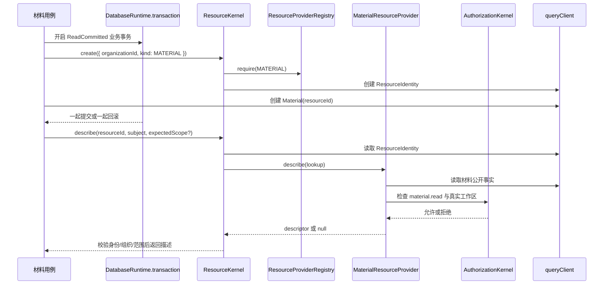

# I05 Resource 实施记录

实施日期：2026-10-18。范围：为材料、附件、任务和审计提供跨模块资源身份与安全描述入口。

I05 交付的是一个小而稳定的 Resource 核心，不把所有业务对象合并成一张资源表，也不把 ResourceIdentity 变成权限图谱。业务模块仍然拥有自己的表、生命周期和所有权规则；Resource 只负责跨模块身份、Provider 发现和授权后的描述投影。

## 已交付

- `ResourceIdentity` 作为组织范围内的稳定资源身份，继续由业务对象通过同一事务建立关联。
- `ResourceKernel.create()` 创建资源身份，并要求调用者已经处于受管事务上下文；未知 `ResourceKind` 没有已注册 Provider 时拒绝创建。
- `ResourceKernel.describe()` 先读取身份，再调用对应 Provider；独立读取使用 `RepeatableRead`，已有事务时加入当前上下文。
- Provider 通过 `@ResourceExtension({ kind })` 注册，由 `ExtensionDiscovery` 在 Nest 启动阶段收集；重复 kind、缺失 Provider、非法 Provider 会阻止可用目录建立。
- Provider 只能返回 `ResourceDescriptor` 或 `null`。`null` 同时覆盖对象不存在和当前主体无权查看，避免通过错误差异泄露对象存在性。
- 核心层运行时校验 Provider 描述：资源 ID、kind、组织必须和 `ResourceIdentity` 一致；调用方给出的组织范围可以包含同组织工作区，工作区范围必须精确匹配；非法描述被拒绝。
- 材料 Provider 复用 `MaterialFactsReader` 和 I04 的材料目标授权逻辑。材料名称、链接、工作区范围只在当前权限检查通过后返回。
- Resource 输入、Provider 元数据和描述字段都有统一的安全诊断；不会把原始 Zod 错误或未限制的 Provider 对象向外传播。

## 运行路径

## 事务和边界

`ResourceKernel.create()` 不自行开启根事务。它使用 `mandatory` 传播，确保材料、设施或其他业务对象在同一个受管事务中创建 ResourceIdentity。业务对象写入失败时，身份不会残留；身份写入失败时，业务对象也不会提交。

`describe()` 是只读能力。没有外层事务时，Resource 核心创建一个 `RepeatableRead` 读取上下文，让身份、业务事实和权限判断使用同一读取快照；有外层事务时，所有查询加入外层上下文。Resource 不读取请求 ALS，也不自行推断当前用户，调用方必须传入已验证的 `PermissionSubject`。

Resource 核心不做业务授权决策。Provider 负责取得实际所有者、工作区和生命周期事实，并调用业务授权入口。这样材料 ID 已知时仍然可以直接走 I04 目标解析；只有附件、审计等跨模块引用场景才需要从 `resourceId` 进入 Resource。

## 材料 Provider

材料创建流程在 `MaterialService.create()` 中先通过当前工作区的创建权限，再在同一事务内调用 Resource 创建身份，随后写入 `Material.resourceId`。材料 Provider 使用 `MaterialFactsReader.byResourceId()` 查找事实，再使用 `AuthorizationKernel` 检查 `material.read`。权限失败、材料不存在或不属于当前组织时都返回 `null`，不返回名称、跳转地址或其他描述信息。

`ResourceDescriptor.scope` 是当前事实，不是可长期复用的授权凭证。材料归档、成员移除或角色变化后，下一次描述会重新读取事实和重新判权。

## 当前限制与后续交接

- 本轮没有新增 Resource HTTP 路由，也没有把所有业务 CRUD 改成 Resource API。
- 目前只有材料 Provider 是真实业务接入；设施、存储拓扑节点、库存实例、任务等 Provider 要在各自业务事实和权限规则确定后接入。
- ResourceIdentity 的模型变更沿用当前 Prisma schema；本轮没有执行 `db push`、迁移或生产数据库写入。
- 节点级权限继承、`ltree` 范围下推、批量授权查询和游标分页属于 I04/I06/P08，不由 I05 偷换实现。
- I08-B 应使用本入口绑定 `FileReference`，但绑定用途、资源授权下载和清理并发协议仍需单独实现。

## 验证

- Backend 全量 build 通过。
- Resource 与材料相关文件的 ESLint、Prettier 检查通过。
- Prisma format 与 validate 通过；没有连接或修改真实数据库。
- 当前验证证明了编译、装配和静态契约；真实 PostgreSQL 的回滚、隔离级别与并发竞争仍需在 P07/P08 的真实业务联调中验收。
