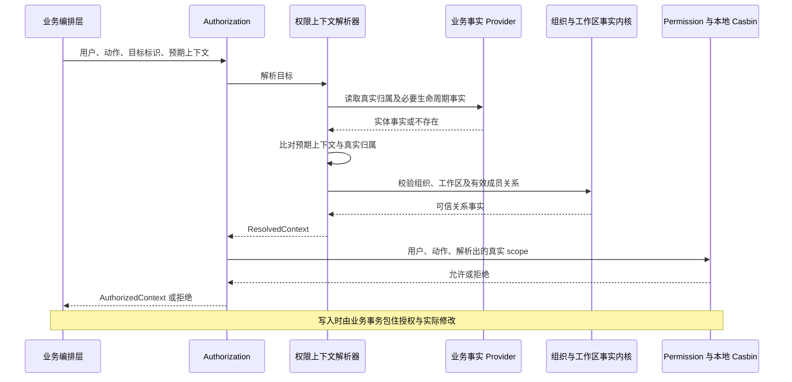

# 权限与权限上下文设计

更新日期：2026-10-18。本文件整理本轮已确认的设计，作为 I04 后续补充及 P07/P08 接入的依据。
它不是新的实施或验收记录，也不授权修改 Schema、执行数据库操作或扩大 MVP 范围。

同日后续已实施 I04 公共补充，接口与隔离验证见[I04 实施记录](mvp-i04-2026-10-18.md)；
首个真实材料 Provider 仍待 P07 接入，下表按该实施后的源码更新。

[2026-10-15 基座记录](permission-authorization-2026-10-15.md)保留当时的接口和验证证据；
本文件补充业务实体上下文解析、Resource 边界、查询授权及前端接入方向。
任务分工见[基础设施协作计划](mvp-foundation-work-plan.md)，业务进度仍以[MVP 主计划](../../../../docs/product/mvp-work-plan.md)为准。

## 1. 已有实现与本轮补充

以下实现状态于本轮静态核对，不代表重新做过运行验收。

| 内容 | 当前实现 | 后续方向 |
| --- | --- | --- |
| `core/session` | 验证登录凭据、会话有效性及撤销状态 | 不承接业务权限判断；原 `core/access` 已改名，不恢复同义模块 |
| `core/permission` | 本地 Casbin、组织/工作区角色绑定、权限目录与受管事务读写 | 保持唯一策略事实源，不接 Casdoor 远程判定 |
| `core/authorization` | `check/require/scope`，支持组织/工作区或业务目标，校验真实 scope、预期上下文及成员关系 | P07 接入首个真实材料 Provider；列表仍使用有限范围 |
| `AuthorizationContextResolver` | 已支持领域事实 Provider 分发、归属比对和 ResolvedContext；目标类型可发现或显式贡献 | 机制已交付，不代表已有材料归属查询或生命周期规则 |
| P06 团队管理 | 已有成员、邀请、角色管理及 capability 响应；验收边界见[P06 记录](mvp-p06-2026-10-15.md) | 不把团队管理完成说成所有业务资源已可授权 |
| I05 Resource | 主要入口及业务 Provider 仍为 TODO | 在 P07 落地跨模块资源身份与引用，不改造成权限图谱 |
| 节点级授权与继承 | 当前权限 scope 和 Schema 不能表达完整规则 | 首发粒度仍须 P08 前确认，不由本轮文档自动启用 |

**统一的权限上下文解析器是 I04 的补充，不是 I05，也不是新增一个顶层 Core。**
I04 公共机制与 P07 首个材料 Provider 配套交付，不能只增加几个空类型就称为完成。

## 2. 各模块分别回答什么

| 概念 | 回答的问题 | 不负责什么 |
| --- | --- | --- |
| Session | 当前请求是谁，登录会话是否仍有效？ | 此人能否读某个材料 |
| OrganizationContext / WorkspaceContext | 组织、工作区和成员关系是否真实有效？ | 根据角色决定允许的业务动作 |
| Permission | 此人在确定的 scope 下，是否持有该动作权限？ | 查询 Material、StorageNode 等业务实体归属 |
| Authorization | 目标究竟属于哪里；上下文是否合法；能否执行；列表可查哪些范围？ | 硬编码所有业务表或接管业务状态机 |
| 业务事实 Provider | 这个实体的真实归属、必要生命周期事实是什么？ | 代替 Permission 授权，或把客户端 scope 当作事实 |
| Resource / ResourceIdentity | 附件、任务、审计引用的是哪个业务对象？ | 保存第二套所有权、角色关系或权限继承图 |

解析完成只产生 **ResolvedContext（已解析上下文）**。Permission 判定通过以后，才产生
**AuthorizedContext（当前操作已授权上下文）**。二者都不是可复用凭据，也不代表下一次请求仍有权限。
I04 补充已将原解析器提前使用 `AuthorizedContext` 的内部语义改正，只有最终允许结果添加 `authorized: true`。

## 3. 单对象操作如何运行



### 调用方向

以下调用结构已获公共接口支持，但 `material.read` 与材料 Provider 仍须 P07 注册，不表示该例目前可以成功授权：

```ts
await authorization.require({
    subject: { kind: 'user', userId },
    permissionCode: 'material.read',
    target: { kind: 'material', id: materialId },
    expectedScope: { kind: 'workspace', organizationId, workspaceId },
});
```

- 保留直接以组织/工作区为目标的现有场景；业务实体目标增加类型与实体 ID，不要求调用方先查归属。
- `expectedScope` 表示本入口期望的上下文，不是授权证据。要求当前工作区的入口必须提供该限制，不能省略后变成跨工作区操作。
- Provider 返回的实际归属才是事实：预期组织必须一致；预期工作区存在时，组织和工作区都必须一致。
- 解析器再校验有效成员关系，并把真实 scope 交给 Permission。组织权限不能自动替代工作区权限。
- 目标不存在、不可用或归属不匹配，不通过响应暴露外组织对象的名称、归属等信息；依赖故障不能伪装成正常无权限。
- 未知权限、未注册目标类型或重复 Provider 属于配置/接入错误，应明确失败，不能默认为允许或无限范围。

I04 补充已将原先“直接把 target 当成 PermissionScope”改为“校验请求与权限定义 -> 解析目标 -> 校验真实 scope 与权限定义兼容 -> 判定”。
目标类型扩展与运行时执行顺序共同生效，不只是增加类型联合分支。

### Provider 与依赖边界

业务模块贡献目标事实 Provider，由 Authorization 宿主维护注册、重复检查和分发，复用 I03 的贡献装配机制。
不扫描业务目录，不靠 import 副作用注册，也不为此把现有所有贡献强制改成隐式发现。
静态定义可以显式装配；需要已有单例依赖的 Provider 使用既有 Discovery 桥接。

Provider 只加载所属领域的实际身份、scope 和本次授权需要的有限事实，不返回整行 Prisma 对象，
不引入任意属性表达式语言。归档对象是否允许某个动作仍由已确认的动作与生命周期规则决定，不能一律猜成可读或不可读。
跨域特殊规则由业务公开能力提供，Authorization 负责调用编排；Casbin 不直接访问业务表。

贡献适配器可以调用业务模块的公开事实查询。该查询本身不能反过来调用 Authorization，
否则会形成“授权 -> 事实查询 -> 授权”的递归。底层受信事实入口不应直接作为公开 HTTP 读取接口。

## 4. 列表不是逐个对象做详情授权

单对象解析用于详情和操作；列表先求可查询范围，再下推到数据库。
不先分页取数据后逐行 `check`，否则页长、总数和后续游标都会与授权范围不一致。

以当前工作区材料列表为例：

1. 取得已认证用户和入口要求的组织/工作区上下文。
2. 调用 `authorization.scope`，用该上下文限制 `material.read` 的查询范围。
3. 将授权 scope 与材料的 `organizationId/workspaceId`、生命周期及用户查询条件取交集。
4. 使用同一授权过滤条件进行分页、统计及导出。业务另外要求组织读权限时，显式相交，不能从组织角色推断工作区权限。

以下为拟接入示例；`material.read` 需由 P07 定义与注册：

```ts
const access = await authorization.scope({
    subject: { kind: 'user', userId },
    permissionCode: 'material.read',
    within: { kind: 'workspace', organizationId, workspaceId },
});

if (access.kind === 'none') return emptyPage();
if (access.kind !== 'workspace') throw new Error('Unexpected material access scope');

const where = {
    AND: [
        { organizationId, workspaceId, archivedAt: null },
        { OR: access.workspaces.map(({ organizationId, workspaceId }) => ({ organizationId, workspaceId })) },
        userFilter,
    ],
};
```

示例的空范围直接返回空页；若交给 Repository，则必须生成恒假条件。不能把 `none`、空 OR
或不支持的范围丢掉，退化为不受限制的 `{}`。查询列名和 ORM/SQL 过滤由业务 Repository 负责，
Core 返回有限的、与 ORM 无关的范围，不返回 Prisma `where`。

目前 scope 只有组织 ID 和组织/工作区组合；它不是任意 Casbin/ReBAC 策略的 SQL 编译器。
目标 Provider 解决单实体归属，不自动解决未来的节点列表可见范围。

## 5. 权限定义、角色和策略何时产生

- **代码定义**：业务模块贡献稳定权限码、名称及作用范围，启动时收集、校验并冻结；定义本身不授予权限。
- **数据库目录**：`Permission` 是代码定义的持久化对应。角色写入按需物化已注册项；`synchronizeCatalog` 是显式操作，不在 Discovery 或普通读取时自动执行。
- **角色与授权**：初始角色随组织/工作区创建及 P06 显式治理初始化写入；自定义角色和绑定由已授权业务操作管理，并与审计同事务。
- **迁移与启动**：Schema/DDL 不替真实组织初始化角色；没有全局启动种子自动给所有组织补权。未知或失效代码不能被授权。

权限定义不是角色模板，角色名也不是授权结论。现有 P06 权限贡献和管理能力继续使用，不退回最初只有几个读权限的基座快照。

## 6. 为什么使用本地 Casbin 与隔离评估

已确定使用本地 Casbin。Casdoor 继续负责身份集成，不承担业务权限远程判定。
`Permission/Role/RolePermission` 及各 scope 绑定表是唯一持久策略源，不引入第二份 `casbin_rule`。
当前模型为精确动作、精确 scope、allow-only；无显式 Deny、隐式所有者放行或组织到工作区的授权继承。

`PermissionEngine` 本身由 Nest 管理为单例，但每次评估批次创建独立 Model/Enforcer，批次内复用。
隔离的是可变策略，不是每行都创建一整套业务服务。这样不同用户、scope 和事务内尚未提交的策略快照不会互相污染。
单例 Enforcer 并非天然不可用；以后若采用不可变、版本化策略快照，可以重新评估，现阶段不预建缓存和分布式失效系统。

### 事务规则

- 业务事实和策略读取均使用 `DatabaseRuntime.queryClient`。独立授权读取使用 RepeatableRead；已有事务则加入，不私自修改外层隔离级别。
- 写入用例由编排层开启事务，解析、授权和实际修改加入同一上下文。成员/策略变更与旧快照并行时的行为受隔离级别约束，不宣称撤权能取消已运行操作。
- 角色/绑定写入要求已有事务；错误被业务捕获后，也不能因此提交受损事务。
- 本地同事务并不代替竞争控制。业务仍须根据用例使用锁、版本或条件写入，保证授权依据与写入不发生未处理的竞争。
- 普通远程判定没有本地事务连接，看不到本地未提交写入；本地回滚也不能撤回远端已提交副作用。网络等待还会延长事务占用。给远端传完整事实快照是另一种协议，不等于远程调用加入了数据库事务。

权限和上下文 Core 接收显式 subject，不自行读取请求 ALS；HTTP/业务入口负责从已验证身份提取用户，不能从请求 body 信任 userId。

## 7. I05 Resource 不变成权限系统

I05 仍回答“跨模块引用的对象是谁”：

- `ResourceIdentity` 是组织内稳定资源身份，业务对象与身份在同一事务建立。
- `FileReference.resourceId` 外键引用该身份；任务、审计等也可通过它关联业务资源，不是文件专用模型。
- 实际工作区归属、生命周期和安全描述由业务 Provider 提供，不复制成第二套所有权事实。
- Resource 不保存 Casbin 策略，不因为有资源 ID 就授予访问，也不要求所有鉴权目标先注册 ResourceIdentity。

材料详情已经知道 materialId，可直接走 I04 的材料目标解析器；附件入口只有 resourceId 时，
先通过 I05 识别实际业务目标，再使用 Authorization 判定。两条路径复用业务事实查询，不维护两套会漂移的归属算法。

Resource 的受信内部解析与面向用户的描述投影要区分；名称和跳转信息在授权后才返回。
编排层组织 Resource 与 Authorization 调用，不让二者互相导入，也不把每个引用转换操作都做成新的权限入口。

## 8. 前端怎么使用

公开 wire 契约继续放在 `packages/contract`，不直接导出 Core、Casbin tuple 或 Prisma 类型。
返回引擎无关的 capability/可操作状态；它们可以同时表达权限和业务限制，不只是一张原始 allow 表。

P06 已有 `canInitialize/canManageMembers/canManageRoles/canInvite` 和角色的 `protected/grantable`，
后续业务沿用这种投影方向。前端不靠角色名推断能力，后端每次真实操作仍重新检查。
账户、工作区切换及权限相关变更后刷新上下文结果，拒绝旧请求晚到覆盖新 scope，并区分加载中、失败与无权。

目前不引入前端权限引擎、不下发完整策略图。CASL 可在以后确有复杂界面组合查询时作为 UI 实现选项，
不是第二套安全边界，也不把 CASL 规则格式固定成公共协议。

## 9. 节点继承与 ltree 分页：长期方向，不是本次交付

`ltree` 表达物理树；授权关系和停止继承需要另有明确模型。子节点可选择不继承，
停止继承不是显式 Deny，也不禁止更深节点获得独立直接授权。

例如 A 有读授权、其后代 C 停止继承、C 下的 E 又被直接授权，可见范围应为：

```text
(subtree(A) - subtree(C)) UNION subtree(E)
```

不能写成对所有授权统一排除 C 子树，否则 E 的直接授权也被错误消除。
未来可用授权锚点与各分支的继承截断边界表达有限查询计划，由 Facility 在参数化 SQL 中落实；
具体授权模型、作用动作和首发粒度仍须确认。单对象判定与列表计划必须遵循同一套规则。

Casbin 不自动将任意 ReBAC 转为 ltree SQL。`batch-enforce` 只能检查给定候选，不能直接生成全部可见对象集合；
逐批扫描再补满页是可能的应用算法，但深分页、精确总数与成本都难保证，不作为存储拓扑的主要查询方案。
改用远程判定也不会自动补出这个范围能力。

授权条件在 SQL 中先于分页和统计。游标绑定过滤、scope 和稳定排序，每页重新授权；
游标不是权限凭据或跨页快照。唯一 ID 兜底、取 pageSize + 1、以下一页前的最后已返回行生成游标，
并在 I06 获准环境中用实际索引和执行计划验证万级节点，不能仅凭 ltree/GiST 就承诺性能。

## 10. 实施位置与交接

下面是建议的增量位置，不要求提前创建全部文件；现有文件优先扩展。

```text
src/core/authorization/
  authorization.contract.ts                  # target、resolved/authorized context
  authorization.kernel.ts                    # check/require/scope 编排
  authorization-target.provider.ts           # 业务事实贡献契约
  internal/authorization.context-resolver.ts  # 分发解析、归属比对、成员校验
  internal/authorization-target.registry.ts   # 宿主校验与贡献索引
  internal/authorization.scope-planner.ts     # 已支持模型的列表范围
src/modules/material/
  contribution/                              # 首个权限目标适配器
  public/                                    # I04/I05 可复用的受信事实查询
src/core/resource/                           # I05 身份、引用及 Provider 宿主
```

### 实施顺序

1. **I04 补充**：扩展目标与上下文契约，分清 resolved/authorized，接入宿主 Provider 索引，保留组织/工作区入口。
2. **P07 配套**：材料模块贡献真实目标事实查询；详情/写入使用解析器，列表下推组织/工作区范围。I04 不硬编码 Material 表。
3. **I05/P07**：实现资源身份、原子创建和首个 Resource Provider，复用材料事实查询，支持后续附件引用。
4. **P08/I06**：先确认设施使用和节点授权粒度，再实施对应模型及查询计划；不因为预留扩展点自动加入节点继承。
5. **前端切片**：随各业务公开 capability 投影，不新增第二个策略事实源。

### 补充项的完成标准

- 材料 ID 可解析出真实归属；伪造 expectedScope、跨组织/工作区及无效成员均不能通过，且拒绝不泄露对象详情。
- 缺失/重复 Provider 和未知权限明确失败；依赖异常不被改写成空范围或正常拒绝。
- 解析成功但无动作授权仍被拒绝；当前组织/工作区检查保持原有业务语义。
- 事实查询不递归授权；I04/I05 复用归属事实且没有模块循环依赖，不要求组织管理对象一律创建资源身份。
- 写入中的授权、业务修改和审计使用同一受管事务；竞争边界按具体用例验证。
- 列表、总数和导出共用授权过滤，`none` 不变成无限范围；首个 Provider 与真实调用一起验收。

初次整理仅改文档；同日后续的 I04 实施已交付公共业务目标解析、类型拆分与 Provider 注册机制，
验证边界见[I04 实施记录](mvp-i04-2026-10-18.md)。真实材料 Provider、I05 及节点查询/继承不在该次实施中，不能据此标记为已完成。
