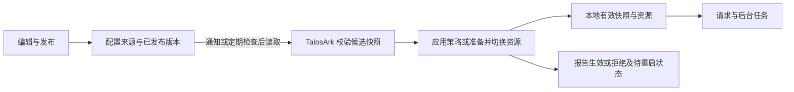
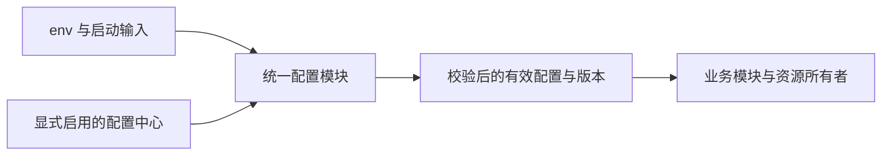

# TalosArk 运行时配置中心选型调研

日期：2026-10-15。状态：决策调研稿；没有选型落地、部署实验或 SDK 集成。

本文按本次决策者已确认的条件讨论：TalosArk 自部署并保留私有化部署能力；尽量覆盖现有 env，少数启动参数允许重启；第一版按部署环境统一配置，组织差异以后再做。

2026-10-15 追加的硬约束：至少支持 **2 vCPU / 2 GB 云服务器上的全栈单实例部署，包括后端、PostgreSQL、Valkey、Casdoor 和 S3 服务全部同机**。该约束改变选型排序；目前没有全栈 2C2G 的实测通过证据。以下为更新后的工程建议，原产品能力比较保留为可选部署参考。

2026-10-15 后续决策：**配置中心属于渐进式、可选支持；只使用 env 文件也必须能完整运行。** 因此默认路线进一步收敛为现有 env 配置，不将独立配置平台或内置 PostgreSQL 配置管理模块设为启动必需。可选支持的约定见第 15 节；具体配置中心产品尚未选定。

资料来自官方文档、项目仓库及具体 SDK 源码。`latest`、`master`、`main` 文档会变化，不能把主分支能力等同于稳定发布能力。性能、端到端生效时间、断网启动及热切换资源行为均未实测。以下“适合”“优先”“需要自建”是根据产品能力与本项目约束作出的工程判断。

## 1. 决策摘要

**默认使用 env 文件完整运行，配置中心按需启用。** 原先的 PostgreSQL 内置轻量配置模块建议调整为候选增强方案，不要求默认先开发配置表、管理界面或发布平台。Apollo 不进入低配默认安装组成，Nacos 保留为资源更充裕或已有独立平台时的可选集成。配置模块负责统一类型校验和有效配置，业务模块不按 env/Nacos/Apollo 分叉。具体渐进支持约定见第 15 节。

Apollo 的发布版本、回滚、实例灰度和编辑/发布权限分离仍有价值；Nacos 的平台复用仍有价值。两者的 Node.js SDK 维护、版本兼容性与应用生效机制仍需单独验证。更新后的资源与 PostgreSQL 事实见第 13 节。

**Consul/etcd 是构建配置中心的底座，选它们意味着自行开发配置发布治理。** 它们可以提供 KV 与变更监听，但版本发布、审批、配置校验、灰度与应用生效状态不是仅接入 KV 就能得到的结果。AWS AppConfig 与 Azure App Configuration 有官方 JavaScript 接入和托管服务，只有允许依赖公有云控制面时才进入候选。

**Unleash/Flagsmith 是功能开关的补充候选。** 用户分群、百分比开关、变体与功能生命周期管理属于它们的优势；把数据库、SMTP、JWT 密钥等全部 env 塞进开关平台，并不能解决资源重建和安全轮换问题。

最关键的边界是：配置中心负责保存、发布和分发数据；TalosArk 仍负责校验新配置、决定何时生效、切换资源，以及报告实际生效版本。配置“收到”不等于配置“已生效”。

## 2. 五类主候选总览

| 方案 | 定位与更新机制 | Node.js/TypeScript 接入 | 本项目收益 | 主要代价与进入条件 |
| --- | --- | --- | --- | --- |
| **Apollo** | 通用配置管理；通知 API 使用 HTTP 长轮询，收到通知后取配置 | 官方文档列出的 Node 客户端来自独立贡献者；官方 Java/.NET 能力不自动适用于这些客户端 | 发布版本、回滚、实例灰度、编辑/发布权限分离；可私有部署 | Java 服务、MySQL、多个服务与环境；接受第三方 SDK 或自己维护一个范围有限的 HTTP 适配器 |
| **Nacos** | 通用配置中心兼服务发现；现代 SDK 可用 gRPC 长连接；已核实的 Node v2.6.3 配置监听使用 HTTP 长轮询 | 最新官方概览把 Node.js 列为**社区 SDK**；发布版本与主分支能力不同 | 配置管理、历史、实例灰度、基础权限；已有 Nacos 基础设施时可复用 | 必须锁定 Server/SDK/协议组合并实测；发布审批要求可能需外部流程 |
| **Consul/etcd 底座** | Consul KV 使用 HTTP blocking query；etcd v3 Watch 使用 gRPC 流 | 官方 HTTP/gRPC API；Node 库的维护归属和行为须单独审核 | 数据监听与并发控制原语；可私有部署 | 自建 schema、发布、审批、历史保留、灰度、客户端缓存和控制台；只在已有运维基础或明确要自建产品时考虑 |
| **AWS AppConfig** | 通用配置与 feature flags；推荐 Agent 在后台轮询，业务进程读本地 HTTP 缓存 | 官方 AWS SDK for JavaScript v3；运行时优先评估 Agent | 校验、渐进部署、监控触发自动回滚 | AWS 账号、IAM、AppConfig/CloudWatch 控制面与用量费用；不满足脱离公有云的完整私有化部署 |
| **Azure App Configuration** | 通用 KV、snapshots、feature flags；JS provider 需应用调用 refresh，按间隔检查 | 官方 JS provider 与低层 JS SDK | JS 接入、配置历史与不可变快照、Azure 身份与权限 | Azure 控制面；不会只开启 refreshOptions 就自动刷新；按实例、请求与附加资源计费 |

机制与 SDK 来源：[Apollo 非 Java/.NET 接入](https://github.com/apolloconfig/apollo/blob/master/docs/zh/client/other-language-client-user-guide.md)、[Apollo Node 客户端列表](https://github.com/apolloconfig/apollo/blob/master/docs/zh/client/nodejs-sdks-user-guide.md)、[Nacos SDK 分类](https://nacos.io/docs/latest/manual/user/overview/other-language/)、[Nacos Node v2.6.3 监听源码](https://github.com/nacos-group/nacos-sdk-nodejs/blob/v2.6.3/packages/nacos-config/src/client_worker.ts)、[Consul blocking queries](https://developer.hashicorp.com/consul/api-docs/features/blocking)、[etcd Watch](https://etcd.io/docs/v3.6/learning/api/)、[AWS Agent](https://docs.aws.amazon.com/appconfig/latest/userguide/appconfig-agent.html)、[Azure JS 动态刷新](https://learn.microsoft.com/en-us/azure/azure-app-configuration/enable-dynamic-configuration-javascript)。

## 3. Apollo：配置发布治理收益与低配边界

### 已核实的能力

- 编辑状态与已发布状态分开：编辑权限可以创建/修改/删除配置，发布权限执行发布/回滚；只有发布后的内容供应用使用。回滚恢复客户端读取的发布版本，页面上的草稿不会同步回滚。[官方使用指南](https://github.com/apolloconfig/apollo/blob/master/docs/zh/portal/apollo-user-guide.md)
- 发布有版本，可做实例灰度，官方示例按客户端 IP 为部分实例返回新配置。它不是直接按 TalosArk 组织或终端用户做分群。[官方灰度流程](https://github.com/apolloconfig/apollo/blob/master/docs/zh/portal/apollo-user-guide.md#五灰度发布使用指南)
- `namespace.lock.switch=true` 可以要求一次发布由一个人编辑、另一个人发布；存在单独的紧急发布开关。这是具体的双人发布约束，不应理解为任意级数的通用审批引擎。[官方部署配置说明](https://github.com/apolloconfig/apollo/blob/master/docs/zh/deployment/distributed-deployment-guide.md)
- 官方项目介绍列出操作审计及客户端配置版本监控。选型验证时仍需检查选定 Node 客户端是否正确上报应用/实例信息，不能因为控制台有入口就推断所有语言均等支持。[官方仓库介绍](https://github.com/apolloconfig/apollo)

### 更新、缓存和 Node 接入

Apollo 的通知协议通过 HTTP 长轮询告知配置变化，客户端再取内容。官方 Java SDK 另外有定时拉取兜底、内存缓存与本地文件缓存；Java 文档给出的默认兜底间隔为 5 分钟。**这些具体缓存和兜底保证属于 Java SDK，不能泛化到全部 Node 包。**[非 Java/.NET HTTP 接入](https://github.com/apolloconfig/apollo/blob/master/docs/zh/client/other-language-client-user-guide.md)、[Java SDK 设计](https://github.com/apolloconfig/apollo/blob/master/docs/zh/client/java-sdk-user-guide.md#四客户端设计)

官方 Node 页面列出多个独立贡献者项目，没有给出统一的“官方维护 Node SDK”保证。其中 `ctrip-apollo` 的项目 README 声明 HTTP 长轮询与磁盘缓存，属于**该第三方客户端的声明**，本次没有运行验证。若采用 Apollo，应比较第三方包近期维护、鉴权、超时/重试、缓存、通知恢复与清理资源能力；也可以自己实现只读、监听、缓存的有限 HTTP 适配器，但这会增加持续维护成本。[Node 客户端列表](https://github.com/apolloconfig/apollo/blob/master/docs/zh/client/nodejs-sdks-user-guide.md)、[ctrip-apollo 项目源码说明](https://github.com/kaelzhang/ctrip-apollo)

客户端读取与监听应使用 Config Service API。开启应用 AccessKey 后，读取请求需带签名和 Timestamp；所选 Node SDK 是否支持该机制必须列为准入项。Portal/Admin 的 OpenAPI 管理 token 不应授予业务实例来充当运行时读配置凭据。[HTTP 客户端鉴权](https://github.com/apolloconfig/apollo/blob/master/docs/zh/client/other-language-client-user-guide.md#15-配置访问密钥)

### 私有化与成本

标准分布式部署有 Portal、Config Service、Admin Service，以及 PortalDB/ConfigDB。官方部署指南说明一套 Portal 可管理多个环境，而每个环境需要对应 Config Service、Admin Service、ConfigDB；采用内置服务发现时 Config Service 也承担 Meta/Eureka 角色，当前文档也有 Kubernetes 原生服务发现路径。依赖 Java 和 MySQL，生产副本数与容错目标另定。[分布式部署指南](https://github.com/apolloconfig/apollo/blob/master/docs/zh/deployment/distributed-deployment-guide.md)、[部署架构](https://github.com/apolloconfig/apollo/blob/master/docs/zh/deployment/deployment-architecture.md)

`ApolloPortalDB` 与每环境的 `ApolloConfigDB` 是逻辑库，**并不强制各用一个独立 MySQL 实例**；可以共用实例，也可以为隔离/高可用分开部署。增加环境会增加 Config/Admin 服务与 ConfigDB，并不一定增加 Portal。

许可证是 Apache-2.0。自托管的主要成本是服务实例、数据库高可用与备份、升级、接入 SSO、监控和 Node 适配维护；没有理由只按软件许可费判断成本低。[官方 LICENSE](https://github.com/apolloconfig/apollo/blob/master/LICENSE)

**判断：**在资源更充裕且生产配置需要明确的“草稿 → 双人发布 → 灰度 → 全量 → 回滚”时，Apollo 值得验证。新增的全栈 2C2G 硬约束下，本轮建议排除其默认安装位置，保留未来外接选项。降低 JVM 参数或使用演示打包方式，不构成低配生产稳定性的证明。

## 4. Nacos：平台复用价值高，Node 版本是先决条件

### 已核实的能力

- 配置以 namespace/group/dataId 标识；支持正式配置与灰度配置。最新 3.2 文档列出 IP Beta 与 Tag 灰度，客户端必须正确传递相应 IP/标签。它们是客户端/实例维度，不是 TalosArk 的组织策略。[配置灰度文档](https://nacos.io/docs/latest/manual/user/config/gray-release/)
- 发布、删除和灰度操作记录历史；当前官方运维说明中的回滚方式是审阅历史内容后重新发布为正式配置。[历史与回滚](https://nacos.io/en/docs/latest/manual/user/config/ops-and-troubleshooting/)
- 默认鉴权有用户、角色、权限与 token；最新文档还列出 LDAP、OIDC/OAuth2 路径。官方把默认实现定位为内网防止业务错用的简单鉴权。权限能力、历史记录与双人审批是不同问题；本次没有找到足以承诺社区版具有 Apollo 同等发布审核流程的依据。[鉴权说明](https://nacos.io/docs/latest/manual/admin/auth/)

### 不能混用的 SDK 与协议事实

1. 最新官方 SDK 概览把 Java/Go/Python 列为官方维护，把 Node.js 列在社区 SDK；即使 Node 仓库位于 `nacos-group` 组织，也不能因此改变这个分类。[官方分类](https://nacos.io/docs/latest/manual/user/overview/other-language/)
2. 本次打开 GitHub Releases 时，最新发布为 **v2.6.3**。该标签的配置客户端源码使用 HTTP listener 长轮询，`Long-Pulling-Timeout` 为 30 秒；服务器有变化即可提前返回，这不是“固定每 30 秒才生效”。`getConfig` 请求失败且存在 snapshot 时会返回 snapshot，没有缓存时抛出错误。[发布页](https://github.com/nacos-group/nacos-sdk-nodejs/releases)、[v2.6.3 源码](https://github.com/nacos-group/nacos-sdk-nodejs/blob/v2.6.3/packages/nacos-config/src/client_worker.ts)
3. Node 仓库主分支 README 已描述 3.x SDK 的 gRPC 与服务端推送，不能据此承诺 npm 稳定版已有相同能力。Nacos 3.x 官方 Client HTTP API 有读取入口，但没有配置监听入口；如果只用该 HTTP API，需要自己轮询，比对 md5。不能把“3.x HTTP 不提供监听”说成“3.x 完全没有 HTTP API”。[Node 主分支说明](https://github.com/nacos-group/nacos-sdk-nodejs)、[Nacos 3.x Client API](https://nacos.io/docs/latest/manual/user/open-api/)

本次**尚未证实已发布 Node v2.6.3 的旧 HTTP listener 与当前 Nacos 3.2 服务端可兼容**。新的 Client HTTP API 支持读取，不能证明旧监听接口仍可使用；主分支描述 3.x/gRPC 也不能证明已发布 npm 包支持。Nacos 只有在固定兼容版本并通过 PoC 后，才保留为可落地候选。Java SDK 的容灾文档和 gRPC 行为不能直接代替 Node v2.6.3 的证据。

### 私有化与成本

Nacos 集群部署文档要求 3 个或以上节点，示例推荐 MySQL，并需要内网入口、相应 HTTP/gRPC 端口、持久化、监控与备份。这是集群部署参考，不意味着单机配置中心必须部署三个节点。也有 Derby/Raft 部署路径，恢复与排障能力需分别考虑。[集群部署](https://nacos.io/docs/latest/manual/admin/deployment/deployment-cluster/)

**补充版本核实：3.2.4 固定标签的标准发行构建已纳入 PostgreSQL 插件、JDBC 驱动和 PG schema。** 因而该版本使用 PG 有主仓库打包证据，可以复用现有 PG 实例内的独立逻辑库/权限，不必为了 Nacos 新增 MySQL；这项结论不自动适用于旧版本。具体发行包内容和 PG 启动尚未实测。[3.2.4 默认插件打包](https://github.com/alibaba/nacos/blob/3.2.4/plugin-default-impl/nacos-default-plugin-all/pom.xml)、[发行 assembly](https://github.com/alibaba/nacos/blob/3.2.4/distribution/release-nacos.xml)

Nacos 服务端开源许可证是 Apache-2.0。云厂商托管版或企业增强的费用和能力须另行核实，不能自动算入社区版。[官方 LICENSE](https://github.com/alibaba/nacos/blob/master/LICENSE)

**判断：**Nacos 可只提供配置服务，微服务或服务发现不是前提；但在全栈 2C2G 默认安装中，额外 JVM 的成本超过当前可证明的收益，建议保留可选集成。PG 复用能消除新增 MySQL 的需要，不能消除 Nacos 进程及 Node 接入维护。

## 5. Consul/etcd：分发底座，不能按完整配置平台计价

### Consul

KV API 支持 `X-Consul-Index` 与 blocking query，实现 HTTP 长轮询；返回不保证一定有变化，客户端需要处理超时、重复结果及 index 回退。KV 读取 API 明确标注 **Agent Caching: none**，所以不能把 Consul Agent 其他接口的缓存能力当作应用 KV 的离线缓存。KV 在数据中心间没有默认内建复制。[Blocking Query 语义](https://developer.hashicorp.com/consul/api-docs/features/blocking)、[KV API](https://developer.hashicorp.com/consul/api-docs/kv)

可以直接用官方 HTTP API；第三方 Node 库只是在其上封装。官方库目录也不能证明某个 Node 包有官方维护承诺。发布历史、可回滚的配置快照、审批、schema 与客户端磁盘缓存需要上层设计。[官方客户端库目录](https://developer.hashicorp.com/consul/api-docs/libraries-and-sdks)

**当前许可证不是宽松开源许可证：**Consul LICENSE 对 1.17.0 及以后采用 BUSL-1.1，当前 licensor 为 IBM；允许组织内部用途，对向第三方提供竞争性嵌入/托管产品有条件限制；每个版本的 Change Date 为发布后四年，届时转 MPL-2.0。TalosArk 私有化交付若附带 Consul，应在选定交付形式下核实许可适用性，不能沿用旧 MPL 印象。[当前 LICENSE](https://github.com/hashicorp/consul/blob/main/LICENSE)、[官方许可 FAQ](https://www.hashicorp.com/license-faq)

### etcd

etcd v3 提供 KV、事务、revision 和双向 gRPC Watch。断连后可从 revision 恢复，但历史压缩后过旧 revision 会使 Watch 被取消，需要重新读取快照并建立 Watch；revision 不是长期保留的业务发布版本。官方库目录的 Node v3 项指向 `mixer/etcd3`，这属于另一个维护主体。[API 与压缩语义](https://etcd.io/docs/v3.6/learning/api/)、[客户端库目录](https://etcd.io/docs/v3.6/integrations/)

许可证是 Apache-2.0。它对磁盘写入延迟与集群网络敏感，需要备份、恢复、压缩、监控与成员管理；本地最后有效配置仍需应用层管理。现有 Kubernetes 集群的控制面 etcd 不应因此直接成为 TalosArk 的业务配置库。[官方 LICENSE](https://github.com/etcd-io/etcd/blob/main/LICENSE)、[硬件与网络要求](https://etcd.io/docs/v3.6/op-guide/hardware/)

**判断：**二者只有在已有平台基础，或我们明确要构建自己的配置治理产品时值得优先。对当前“运行时配置中心”的目标，软件组件可能少，但开发与维护范围会更大。

## 6. AWS/Azure：公有云依赖允许时的条件备选

### AWS AppConfig

AWS AppConfig 支持 free-form 配置与 feature flags。官方推荐 Agent：后台定期轮询 AppConfig，应用从本机 HTTP 读取内存缓存；不是配置服务直接推送到 Nest 实例。官方 AWS SDK for JavaScript v3 有 AppConfigData 接口，但自己调用时需管理 session token、下一次轮询和缓存。[Agent 工作方式](https://docs.aws.amazon.com/appconfig/latest/userguide/appconfig-agent.html)、[JS v3 AppConfigData](https://docs.aws.amazon.com/AWSJavaScriptSDK/v3/latest/client/appconfigdata/)

它提供 JSON Schema/Lambda 校验、渐进部署策略与 CloudWatch 报警触发自动回滚；权限由 IAM 管理，API 操作可通过 CloudTrail 记录。人工审批流程应单独设计或接入发布流水线，不能把自动回滚与人工审核混为一谈。[Validators](https://docs.aws.amazon.com/appconfig/latest/userguide/appconfig-creating-configuration-and-profile-validators.html)、[部署策略](https://docs.aws.amazon.com/appconfig/latest/userguide/appconfig-creating-deployment-strategy.html)、[自动回滚](https://docs.aws.amazon.com/appconfig/latest/userguide/setting-up-appconfig.html)、[CloudTrail](https://docs.aws.amazon.com/appconfig/latest/userguide/logging-using-cloudtrail.html)

Agent 容器可配置 `BACKUP_DIRECTORY` 和 `PRELOAD_BACKUPS` 从磁盘恢复；该能力需要显式配置并使用持久化存储。`writeTo` 只是将配置写到文件，Agent 不从这些副本读取，因此不是备份恢复功能。首次部署没有远端连接也没有已有备份时，缓存不能凭空生成初始配置。[Agent 备份变量](https://docs.aws.amazon.com/appconfig/latest/userguide/appconfig-integration-containers-agent-configuring.html)、[写入磁盘的区别](https://docs.aws.amazon.com/appconfig/latest/userguide/appconfig-agent-how-to-use-additional-features-write-to-disk.html)

计费看配置 API 请求数与实际收到的配置数，外加所用监控、存储、事件等服务费用；轮询间隔、实例数、配置文档数与变更频率共同影响费用。Agent 可减少业务请求造成的远端调用，但不消除后台轮询计费。本文不报地区/合同未知情况下的月费。[官方价格页](https://aws.amazon.com/systems-manager/pricing/)

### Azure App Configuration

官方运行时库是 `@azure/app-configuration-provider`，低层 `@azure/app-configuration` 用于细粒度读取与管理操作。JavaScript 动态刷新需要应用主动调用 `refresh()`，实际远端检查受 refresh interval 限制；设置选项不会自动启动后台循环。刷新失败后使用已缓存的配置，**不等于已经承诺重启进程后也能从磁盘离线恢复**。HTTP 请求驱动的刷新也不保证空闲 worker 自动更新。[JS provider](https://learn.microsoft.com/en-us/azure/azure-app-configuration/reference-javascript-provider)、[JS 动态配置](https://learn.microsoft.com/en-us/azure/azure-app-configuration/enable-dynamic-configuration-javascript)

服务有配置变更事件，官方 push-refresh 教程使用 Event Grid、Service Bus 和 .NET provider；这个教程不能用来承诺 JS provider 有相同 `ProcessPushNotification` 接口。若 Node 需要事件加速刷新，必须验证具体 JS 库能力或维护事件接收适配器。[官方 .NET 推送教程](https://learn.microsoft.com/en-us/azure/azure-app-configuration/enable-dynamic-configuration-dotnet-core-push-refresh)

它提供 key 历史恢复和不可变命名 snapshots，快照可以构建版本与回滚机制；生产发布、灰度扩大及审批应结合流水线设计。身份权限可用 Entra ID、managed identity 与 Azure RBAC；数据面审计需配置相应 resource logs，Activity Log 只反映控制面操作，不能替代 key 写入审计。[历史恢复](https://learn.microsoft.com/en-us/azure/azure-app-configuration/concept-point-time-snapshot)、[Snapshots](https://learn.microsoft.com/en-us/azure/azure-app-configuration/concept-snapshots)、[监控与日志](https://learn.microsoft.com/en-us/azure/azure-app-configuration/monitor-app-configuration)

费用按 tier 的 store 日费、请求配额与超额请求，以及 replica/监控等附加服务衡量；不同 tier 的历史保留与配额不同。本文不将免费 tier 当生产预算或可用性保证。[官方 FAQ](https://learn.microsoft.com/en-us/azure/azure-app-configuration/faq)、[官方价格](https://azure.microsoft.com/en-us/pricing/details/app-configuration/)

**判断：**托管配置平台能减少控制面运维，但 TalosArk 私有化部署仍必须访问该云端服务，离线缓存只是缓冲。当前确认的私有化目标使这两项处于条件备选位置。

## 7. 功能开关补充：Unleash 与 Flagsmith

| 维度 | Unleash | Flagsmith |
| --- | --- | --- |
| 定位 | Feature flags、策略、分群、渐进开放、变体 | Feature flags 加 remote config、用户/segment 覆盖 |
| 官方 Node 接入 | `unleash-client`，后端本地判断；默认定时拉取配置 | 当前官方包为 `@flagsmith/nodejs`；旧 `flagsmith-nodejs` 在 v9 后弃用 |
| 缓存/离线 | Node SDK 默认写磁盘备份，可 bootstrap；首次未同步且无 bootstrap 时 flag 默认 false | 默认 Remote Evaluation 会请求 API；Local Evaluation 周期抓 environment document 并本地判断；可显式配置 LocalFileHandler/offlineMode |
| 推送边界 | Node SDK 文档仍按轮询描述；Enterprise Edge 的 streaming 不能自动推断为 Node SDK 直连推送 | 官方服务端指南明确 Local Evaluation 默认按 60 秒轮询；实时更新是否适用于所选 Node SDK/版本需另查，不按宣传“实时”承诺 |
| 治理与费用 | OSS 有基础审计；change requests、复杂权限等要区分 Enterprise | 核心开关、remote config、用户定位为 BSD 核心；审计、审批、SSO 等为 Enterprise 增强 |

表格来源：[Unleash Node SDK](https://docs.getunleash.io/sdks/node)、[Unleash SDK 行为](https://docs.getunleash.io/sdks)、[Unleash Edge streaming](https://docs.getunleash.io/unleash-edge)、[Unleash 版本能力对比](https://docs.getunleash.io/support/oss-comparison)、[Flagsmith 服务端 SDK](https://docs.flagsmith.com/integrating-with-flagsmith/sdks/server-side)、[Flagsmith 核心与 Enterprise](https://www.flagsmith.com/open-source)。

许可证存在明显版本边界：Unleash 官方升级指南说明，从 **v8.0.0** 起服务端仓库源码和 `unleash-server` npm 包改为 AGPLv3，官方未修改 Docker 镜像仍按 Apache-2.0 提供，SDK 不受该变化影响；不能笼统说“Unleash 全部 Apache-2.0”。Flagsmith 核心为 BSD-3-Clause，Enterprise 部分按商业条款提供。[Unleash v8 升级说明](https://docs.getunleash.io/deploy/upgrading-unleash)、[Flagsmith 开源范围](https://www.flagsmith.com/open-source)

自托管仍有服务与数据库运维：Unleash 使用 PostgreSQL；Flagsmith 有 API、Dashboard 和持久化数据库等组件。选择它们作为功能开关补充需要单独评估治理收费、客户端规模和日常运维。Flagsmith SaaS 请求计费取决于 Remote/Local Evaluation 模式，后者主要受实例数与轮询频率影响；不要用前端用户数直接估计后端 Local Evaluation 的调用量。[Unleash 部署](https://docs.getunleash.io/deploy/getting-started)、[Flagsmith 架构](https://docs.flagsmith.com/flagsmith-concepts/platform-architecture)、[Flagsmith 用量计费](https://docs.flagsmith.com/administration-and-security/billing-api-usage)

**判断：**第一版只按部署环境配置，尚无强分群开关需求，暂不增加第二个平台。将来需要组织/用户灰度功能时再评估；组织业务规则也不应自动等同为 feature flags。

## 8. 私有化部署的可计数成本与轻量自建备选

用户在了解组件成本后补充了全栈 2C2G 硬约束。以下按一个独立客户/部署单元计数；环境若共用同一平台则可共享部分组件，若要求隔离则复制相应单元。逻辑库、服务角色、运行副本和物理主机不是同一个数量。

| 方案 | 试用/标准拆分起点 | 高可用时额外组成 | 代价主要落点 |
| --- | --- | --- | --- |
| Nacos | 单机 1 个 Nacos 节点；可用内置存储；3.2.4 标准发行构建也包含 PG 插件，可复用现有 PG 的独立逻辑库 | 官方集群起点 3 个或以上节点；数据库高可用、持久卷和内网入口另计；独立控制台若选用另计 | 新增 JVM、数据库/存储、备份恢复、升级和 Node 兼容；2C2G 全栈默认方案不纳入 |
| Apollo | 一个环境的标准拆分是 Portal、Config、Admin 三个 Java 服务角色；两个逻辑库可以在同一 MySQL 实例；试用打包方式不作为 HA 规模 | Config/Admin 随环境增加，Portal 可共享。按每角色 1 个副本计，E 个环境的 Java 服务数量为 **1 + 2E**，逻辑库为 **1 + E**；这是拓扑计数，HA 副本和 MySQL 实例按容错/隔离要求另定 | Java 运行资源、MySQL、多个服务的网络与升级、环境拓扑、Node 适配；换取现成发布治理 |
| 基于现有 PostgreSQL 的内置轻量模块（自建） | 若管理 API、界面与分发逻辑都放在现有 TalosArk 进程，且复用现有 PostgreSQL，可为 **0 个新增常驻服务** | 复用后端/数据库 HA；独立通知代理或管理进程若后来需要则另计 | 版本、校验、发布、审计、审批、回滚、缓存和补拉全部由我们开发维护；并非现成成熟配置中心 |

组件计数依据：[Nacos 单机部署](https://nacos.io/docs/latest/manual/admin/deployment/deployment-standalone/)、[Nacos 集群部署](https://nacos.io/docs/latest/manual/admin/deployment/deployment-cluster/)、[Apollo 部署架构](https://github.com/apolloconfig/apollo/blob/master/docs/zh/deployment/deployment-architecture.md)、[Apollo 分布式部署](https://github.com/apolloconfig/apollo/blob/master/docs/zh/deployment/distributed-deployment-guide.md)。自建行是本项目工程推断；0 新服务不等于 0 资源、0 研发或 0 运维成本。本文没有足够已验证硬件与负载数据，因此不报最低内存、月费或研发人日。

Nacos 环境可以通过 namespace 共用同一集群来减少节点数量，但 namespace 是逻辑隔离，不能当作独立集群的故障与物理隔离。每个私有客户若独立部署，则分别承担该部署单元的组件与升级成本。

轻量自建可以把数据库作为版本来源，先定时拉取有效配置版本，再用 PostgreSQL `LISTEN/NOTIFY` 或已有 Valkey 通知加速。通知只表达“可能有新版本”，应用随后拉取完整快照；不能把通知当可靠配置日志。PostgreSQL 会话结束会清理 LISTEN 注册；Valkey Pub/Sub 明确采用 at-most-once，断线期间的消息会丢失，因此仍需重连补拉和定期检查。[PostgreSQL LISTEN](https://www.postgresql.org/docs/current/sql-listen.html)、[Valkey Pub/Sub](https://valkey.io/topics/pubsub/)

若配置保存在业务 PostgreSQL，`DATABASE_URL`、初始凭据以及识别配置来源所需的参数必须有独立启动来源，否则出现“需要先连接数据库才能知道如何连接数据库”的循环依赖。秘密轮换、Kubernetes ConfigMap、前端公开配置是独立边界，不在第一版强行增加平台。**无论选现成中心还是内置模块，都需承担下面的应用生效改造。**

## 9. 本项目的改造成本：更换来源之外还有应用生效层

本次源码审查确认：当前 `ConfigModule.forRoot/load allConfig` 在启动时加载；`parseEnvironment` 读取 `process.env`。项目没有本次所讨论的远程配置分发与热更新机制。下表描述当前消费者与改造判断，不代表已经实现这些能力。

| 当前消费者 | 当前实现证据 | 动态化需处理的事情 |
| --- | --- | --- |
| env 输入和校验 | `packages/backend/src/config/internal/config.validation.ts` 的 `parseEnvironment`；`bootstrap/composition/app.module.ts` 的配置加载 | 将原始 env 输入与远程运行时配置快照分开；运行时更新也需完整类型/跨字段校验 |
| Database / Redis | `infra/database/database.client.ts:27-49` 构造 PrismaPg/PrismaClient；`infra/kvs/kvs.module.ts:15-18` 创建 Redis | 新资源预连接，健康确认后切换，保留旧连接供在途工作完成；失败保留旧配置与资源；不能只改字符串 |
| Mail / Storage / IAM composition | `bootstrap/composition/infra.composition.ts` 工厂提供 IAM/Mail/Storage；`infra/mail/mail.service.ts:28-32` 构造 transport | 改造已固定的 options/实例生命周期；不同适配器分别判断可重配、可替换或需重启 |
| Casdoor 配置/证书 | `infra/iam/iam.options.ts:58` 冻结；`casdoor.token-verifier.ts:17-19` 解析证书 | 认证参数与验证器必须同版本切换；证书更新另需兼容有效 token 与上游变化 |
| HTTP 策略 | `CorsMiddleware:31-47`、`TimeoutInterceptor:17-21` 构造时缓存；`app.module.ts:49-63` 加载 Throttler | 让请求使用有效快照；限流变更还需判断现有计数器与新窗口如何相接 |
| JWT 策略与密钥 | `AccessKernel:55-60` 一次解析双钥；`generateTokenPair:588` 每次读取 expiry；token header 当前没有 `kid` | 在线密钥轮换需 key ring、key ID 与旧验证钥过渡；TTL 修改只影响新签发 token；一次签发应采用同一策略版本 |
| 并发参数 | Mail transport、password-recovery service 与 password hasher 构造时缓存相关并发参数 | 不属于已具备动态能力的每次读取路径；需重配对应并发控制器或受控重启 |
| 认证尝试与恢复策略 | auth-attempt-limiter 和恢复策略每次读取 ConfigService | 读取位置较容易改造，但仍需要更新来源、请求快照、跨字段约束及旧状态兼容 |
| 前端 API base | `packages/frontend/src/main.ts:21` 的 `VITE_API_BASE_URL` | 属于构建输入；若要部署后修改，另需公开配置接口或部署 config.json 与加载策略；不能把秘密下发给浏览器 |

上表目录路径以当前仓库为基准；适配器的安全切换与请求快照属于设计判断，还需 PoC 验证。对于具备长期连接和在途事务的资源，允许重启可以显著降低第一版实现与恢复成本。

前端构建期替换依据：[Vite env 文档](https://vite.dev/guide/env-and-mode)。当前 queue 配置仍有 TODO，不能从目录或配置文件存在推断队列功能已实现。

## 10. 下一轮值得决策者确认的事项

1. **生产审核：**配置编辑者是否必须由另一人发布；哪些参数允许应急单人发布？如果需要双人约束，Apollo 的既有能力更有价值。
2. **小型私有化部署成本：**已确认 2C2G 全栈同机目标。先为现有组成建立启动、常驻与业务峰值预算，再核算配置模块的增量；更大部署的可选外接平台单独计价。
3. **更新延迟：**普通策略 10～30 秒、紧急开关数秒分别是否足够？这是可选择的目标，不是厂商 SLA。更低延迟仍需结合重试、轮询成本与实例规模。
4. **断连规则：**运行中继续最后有效版本多久？无缓存冷启动是否拒绝服务、使用打包基线，或仅允许运维恢复模式？涉及访问控制的参数是否设最大陈旧时间？
5. **资源重配：**数据库/Redis/存储 provider 切换也要求不停机，还是可以先采用受控重启？这是最影响 TalosArk 改造工作量的一项。
6. **敏感值：**配置中心持有密钥明文、密文还是 secret 引用？谁可以查看、谁可以修改、谁可以发布要分别判断；缓存文件同样属于密钥复制面。
7. **发布单位：**按模块发布还是整套版本？IAM/Casdoor/JWT 等关联参数应同批校验和应用；配置回滚不能撤销已经产生的外部业务副作用。
8. **成功证据：**“已发布”之外，是否要求每个实例报告收到、校验、应用、拒绝与待重启状态，并显示生效版本、更新时间和最近失败原因？

## 11. 建议的最小验证范围

默认部署先确认只使用 env 时能够完整运行，并验证全栈资源预算。将来接入配置中心时，只固定一个选定产品的 Server/SDK 组合，不同时集成全部产品。以下是可选动态生效机制的准入条件，不是本轮已执行的测试。

- 用一组跨字段约束的 HTTP/认证策略验证：草稿不生效、正式发布生效、坏配置拒绝、回滚到前一有效版本。
- 验证两实例先灰度再全量；判断灰度目标是实例还是用户，验证控制台记录与应用实际版本一致。
- 验证断网运行、无缓存冷启动、有缓存重启、恢复连接、通知重复/乱序，以及持久化卷丢失。
- 验证一个需要重建的资源（例如 SMTP transport）：新配置失败时仍使用旧资源，切换时不出现半套新旧配置。
- 验证权限拒绝、凭据轮换、敏感配置日志/缓存边界，以及 SDK shutdown 后没有遗留轮询。

通过这些检查才能比较两者对 TalosArk 的真实接入代价。公开产品介绍中的实时、可靠、开箱即用，不作为本项目验证结论。

## 12. 建议先确定的应用生效设计

以下是决策草案，不是已实现的接口或运行保证。建议分别衡量“配置中心管理覆盖率”和“无需重启的动态生效覆盖率”：一项配置可以在中心保存、发布和追踪，但仍标记为待重启；构建信息与 CLI 输入则有各自的权威来源。

| 类别 | 本项目例子 | 建议的生效约定 |
| --- | --- | --- |
| 策略与普通参数 | 请求超时、CORS、限流、认证尝试限制、恢复冷却、日志等级 | 新请求/任务使用新快照；一次操作内的关联参数保持同一版本。日志等级等由组件主动重配，不能仅修改 ConfigService |
| 资源配置 | SMTP、S3 客户端、Redis 连接配置 | 先创建并验证新资源，再切换后续操作使用的资源；旧资源排空后关闭。失败保留旧资源和已生效版本，必要时标记待重启 |
| 认证材料与协议 | JWT 双钥、Casdoor 证书/issuer/client、Cookie 安全策略 | 设定轮换与兼容窗口；新签发与旧验证材料有明确过渡。当前 JWT header 没有 kid，不能直接替换双钥并承诺会话连续性 |
| 启动与依赖定位 | PORT、NODE_ENV、配置来源地址/初始认证、DATABASE_URL | 保留独立启动输入；端口/启动模式以重启生效，数据库目标切换第一版建议受控重启，另行评估是否必须热切换 |
| 构建、工具或外部状态 | APP_VERSION、GIT_COMMIT、Prisma CLI 的 SHADOW_DATABASE_URL、前端 VITE 输入、已有 S3 对象位置 | 构建身份建议只读展示；工具配置单独管理；前端公开配置另设入口；更改 bucket/endpoint 不等于迁移已有数据 |

当前启动与构建身份证据为 `packages/backend/src/config/app.config.ts`、`packages/backend/src/bootstrap/bootstrap.ts`；日志初始化证据为 `packages/backend/src/platform/observability/logger/logger.module.ts`。`SHADOW_DATABASE_URL` 同时出现在后端 schema 与 Prisma CLI 路径，不能据此把影子库操作算成运行时业务功能。

建议分发和应用采用如下关系。具体产品可以提供长轮询、推送或轮询，TalosArk 的生效过程保持一致：

- **业务请求读取本地有效快照。** 不把配置中心的网络请求放进每个业务请求的必经路径。通知与拉取可以结合，定期检查/重连补拉用于修复遗漏。
- **关联配置按组发布和验证。** 例如同一组认证策略、SMTP 设置。先将 env 字符串和远程 JSON 分别归一化，再验证类型、上下界与跨字段约束；不要把修改 process.env 当作动态生效接口。
- **整组策略切换与跨资源切换分别处理。** 本进程的不可变快照可以一次替换；SMTP、Redis、认证器等外部资源不天然组成一个可原子提交的事务。按配置组定义准备、激活、失败保留和补偿边界，不承诺各实例在同一时刻切换。
- **生效状态必须可核对。** 至少区分已发布、已收到、已应用、拒绝和待重启，并显示实例当前版本与失败原因。普通回滚是恢复配置版本，不能撤销已发送邮件或其他已经完成的外部操作。
- **断连运行与冷启动分别决策。** 运行中可继续最后有效快照；重启后能否恢复依赖持久缓存/打包基线及其允许的陈旧时间。没有任何可信配置时，对必需配置不自动采用任意空值或默认值。
- **秘密与普通配置有不同可见权限。** 审计记录操作者、键、版本和结果，秘密值不进入普通差异日志、前端响应或错误诊断。是否引入独立秘密服务是后续选择；OpenBao 可提供数据库凭据生成与轮换，但不会自动完成 TalosArk 连接的切换。[OpenBao 数据库秘密引擎](https://openbao.org/docs/secrets/databases/)

若部署在 Kubernetes，只把 ConfigMap 注入 env 不会让已有 Pod 的变量自动更新，仍需 Pod 重启；挂载文件更新后，应用也需要自己的重新读取和应用逻辑。[Kubernetes ConfigMap](https://kubernetes.io/docs/concepts/configuration/configmap/)

对未来的组织差异，建议先记录“平台配置”与“组织业务设置”的所有者和权限边界；第一版不增加组织覆盖层。高频、需与业务数据在同一事务修改的组织设置，应作为业务模型评估，而不是默认把每个组织扩展成一个配置中心 namespace。

## 13. 2C2G 全栈约束下的补充评估

本节核对固定版本的默认值和打包配置；没有运行 Nacos、没有下载核验发布包，也没有全栈低配实测。不能把默认堆大小当作最低内存或进程实际占用。

### Nacos 内存与功能模式

| Nacos 3.2.4 安装方式 | 已核实的默认设置 | 对预算的含义 |
| --- | --- | --- |
| 标准发行包 standalone | startup.sh 默认 Xms/Xmx 为 512m，Xmn 为 256m；支持 CUSTOM_NACOS_MEMORY 覆盖 | 这是 Java heap 设置，仍需计入线程栈、类元数据、JIT、直接缓冲等非堆/原生内存 |
| 官方 Docker v3.2.4 | Dockerfile 设置 JVM_XMS/JVM_XMX 为 1g，JVM_XMN 为 512m；standalone 脚本使用这些值 | 默认初始/最大堆已占 2 GB 整机预算的很大部分；不能套用发行包的 512m 默认值 |

来源：[固定标签 startup.sh](https://github.com/alibaba/nacos/blob/3.2.4/distribution/bin/startup.sh)、[Dockerfile](https://github.com/nacos-group/nacos-docker/blob/v3.2.4/build/Dockerfile)、[Docker 启动脚本](https://github.com/nacos-group/nacos-docker/blob/v3.2.4/build/bin/docker-startup.sh)、[Java 参数说明](https://docs.oracle.com/en/java/javase/17/docs/specs/man/java.html)、[JVM 原生内存跟踪](https://docs.oracle.com/en/java/javase/17/vm/native-memory-tracking.html)。

`startup.sh -m standalone -f config` 可以单独加载配置中心；Docker 对应 `MODE=standalone`、`FUNCTION_MODE=config`。TalosArk 不需要拆分微服务，也不需要使用 Nacos 服务发现。只启用配置功能与降低堆大小是调优方向，本轮没有量化其节省量或稳定工作负载。[固定标签功能参数](https://github.com/alibaba/nacos/blob/3.2.4/distribution/bin/startup.sh)、[系统参数](https://nacos.io/docs/latest/manual/admin/system-configurations/)

旧 2.x 官方部署文档建议 2 核/4G 以上；这个版本化建议不能冒充 3.2.4 的硬性最低规格，也没有提供全栈 2C2G 的通过证据。[旧版本部署建议](https://nacos.io/en/docs/guide/admin/deployment/)

### PostgreSQL 支持的版本边界

3.2.4 主仓库的 `nacos-default-plugin-all` 依赖 `nacos-datasource-plugin-postgresql` 与 PG JDBC driver，构建复制插件到发行 `plugins`，复制 PG schema/授权/迁移脚本到 `conf`；release assembly 包含这两个目录。因此该版本标准构建已包含所需 PG 组件，不能继续笼统描述为只能使用 MySQL 或必须安装旧社区 PG 插件。[默认插件构建](https://github.com/alibaba/nacos/blob/3.2.4/plugin-default-impl/nacos-default-plugin-all/pom.xml)、[发行 assembly](https://github.com/alibaba/nacos/blob/3.2.4/distribution/release-nacos.xml)

接入仍需初始化 PG schema、配置 `spring.sql.init.platform=postgresql` 和 JDBC 连接，设置 PG driver/连接验证参数，并给 Nacos 单独的库或 schema 与数据库权限。复用同一个 PG 进程可以省去 MySQL，Nacos 的表和业务表不应混为同一套迁移。[PG schema](https://github.com/alibaba/nacos/blob/3.2.4/plugin-default-impl/nacos-default-datasource-plugin/nacos-datasource-plugin-postgresql/src/main/resources/META-INF/pg-schema.sql)、[多数据源文档](https://nacos.io/docs/latest/plugin/datasource-plugin/)

旧版本外挂插件要按插件/服务端对应表处理，不能把旧插件 JAR 无条件用于 3.2.4。当前官方插件仓库 README 已说明 PG 实现迁入主仓库。[插件仓库](https://github.com/nacos-group/nacos-plugin)

### 整套依赖的基线仍需验证

当前 `packages/backend/ops/docker/compose/full/compose.yaml` 定义 PostgreSQL、Valkey、RustFS、Casdoor 和 backend；Casdoor 配置使用 PG。该 compose 当前没有对整套服务给出 2C2G 资源预算或性能保证。

RustFS 官方硬件选择页给测试环境 1 GB+，Linux 先决条件页给测试环境至少 2 GB，两处口径不同；这些也不是本项目单节点小负载的 RSS 实测。不能据此证明 2C2G 一定不能运行，但不能把默认 full compose 当成已经符合 2C2G 全栈生产目标。[硬件选择](https://docs.rustfs.com/en/installation/requirement/checklists/hardware-selection)、[Linux 内存要求](https://docs.rustfs.com/en/installation/linux/prerequisites-and-service)

后续容量验收应固定运行版本、工作负载与 Linux 整机资源，使用预构建镜像，分别观察冷启动、空闲、正常并发和登录/密码哈希/上传/配置发布/数据库维护的峰值。内存需要包含内核、页缓存和文件处理余量；限制单个容器或 JVM heap 不等于限制整套环境。标准应至少排除 OOM 与持续依赖 swap 的运行，并设置可接受的请求延迟、上传并发及恢复时间。当前没有这些验收的通过结论。

按后续决策更新：**默认保持 env 独立运行；内置 PG 配置管理和外接配置平台均为可选增强。先验证已有全栈的 2C2G 基线；Nacos 作为可选配置来源保留，Apollo 不进入低配默认组成。**

## 14. Consul BUSL 与 AGPLv3 的区别

BUSL-1.1 是 Business Source License，不是 Boost 的 BSL-1.0。它是带使用范围限制的源码可见许可证，在约定转换日期之前不属于开源许可证；不同项目的 Additional Use Grant 可以不同。因此不能只看 BUSL 名字就断言所有生产或商业用途都被禁止。[BUSL 原文](https://mariadb.com/bsl11/)

| 维度 | AGPLv3 | Consul 当前 BUSL-1.1 |
| --- | --- | --- |
| 商业使用/收费 | 可以，仍需履行对应许可义务 | Additional Use Grant 允许非竞争范围的生产使用；特定收费竞争性托管/嵌入受限制 |
| 主要约束 | 发布覆盖作品的源码与许可义务；修改程序后供网络交互还须向相应用户提供该版本的 Corresponding Source | 使用是否落入 licensor 定义的竞争性产品；超出授权范围需商业许可或停止该用法 |
| 公开源码是否足够 | 源码义务之外还须满足许可证的其他条件 | 公开源码并不会自动解除竞争性生产用途限制 |
| 时间变化 | 没有自动变成宽松许可证的期限 | Consul 每个覆盖版本发布满四年转 MPL-2.0，新版本分别计时 |

AGPLv3 允许收费；第 13 条针对修改后程序的远程网络交互规定源码获取机会。分发二进制也有相应义务。通过独立服务 API 使用 AGPL 程序，不代表整个调用方系统自动成为同一个派生作品；需要看实际组合与通信语义，不按同一台主机或同一个 compose 判断。[AGPLv3](https://www.gnu.org/licenses/agpl-3.0.en.html)、[GNU 独立程序与组合说明](https://www.gnu.org/licenses/gpl-faq.en.html#MereAggregation)

Consul 当前 LICENSE 允许组织内部使用；受限制的是向第三方提供与 licensor 付费版本能力显著重叠的收费竞争性托管或嵌入产品，收费支持也计入。Embedded 定义还覆盖让竞争性产品运行时必须访问或下载该软件的包装方式，不只限于复制进一个二进制。TalosArk 作为资产管理产品，在这一定义下是否属于竞争性产品需要按具体交付结构核对；私有化收费、SaaS 或带有 Consul 依赖本身不等于已经违反条款。[Consul 当前 LICENSE](https://github.com/hashicorp/consul/blob/main/LICENSE)

对 TalosArk 的工程判断：作为普通非竞争依赖，BUSL 未必比 AGPL 更难使用；若未来要商业化派生或提供可替代平台，BUSL 的竞争边界比按源码义务处理的 AGPL 更难形成长期可预期的规则。当前又无必须使用 Consul 的收益，优先避开这项额外许可判断。

仓库根 `package.json` 与 backend 的 package.json 当前都声明 AGPL-3.0；这是本项目自身的发行许可，与 Consul 使用范围判断分别处理，不以本项目开源来豁免第三方 BUSL 条款。

## 15. 已确认方向：env 默认运行与配置中心渐进支持

本节记录用户已确认的产品方向及建议的技术约定；未实现运行时接入，也未新增 env 字段或确定供应商。目标是：使用 env 的部署能完整运行，可选中心增加管理与刷新能力，配置来源的选择不会改变业务模块的配置语义。

| 模式 | 加载与运行依赖 | 生效方式与能力 |
| --- | --- | --- |
| 默认 env 模式 | 使用现有 env 文件/进程环境及必要秘密文件；满足必需字段校验；不初始化中心 SDK、网络连接或监听任务 | 默认修改后重启生效；保持完整业务运行能力，不要求配置表、中心控制台或发布审批流程 |
| 显式启用中心 | env 提供中心定位/初始认证等启动信息；接入一个选定配置来源，读取其已发布配置 | 对已支持的配置组增加动态刷新、版本与集中发布能力；资源重建、密钥轮换和待重启规则仍由 TalosArk 执行 |

### 统一配置模块与来源职责

建议将变化的 seam 放在配置来源的加载/更新处：env 和选定中心的 adapter 负责获取输入；配置模块统一归一化、类型/跨字段校验、发布有效快照及报告应用状态。业务模块只依赖类型化配置 interface，不接触供应商 SDK，也不判断是否启用了中心。

现阶段保留现有 env 加载和配置消费者。选择具体中心并实施接入时，再为实际消费者补齐动态读取或资源重配；不提前实现所有候选 adapter，不建立通用插件市场或管理平台。第 9 节列出的构造缓存不会因新增来源而自动动态化。

### 加载顺序与优先级建议

1. 从 env/文件读取启动信息，确定是否启用中心。中心地址、初始认证和来源定位不能依赖中心自身提供。
2. 默认模式直接加载 env 并验证完整配置，按照现有启动路径运行。
3. 启用中心后读取 env 基线与中心已发布的配置组；在声明由中心管理的组内，建议优先级为 **中心已发布值 > env 基线 > schema 默认值**。启动参数继续由部署输入管理。
4. 对合并后的完整候选组校验；通过后才能成为有效配置。明确缺失、删除及空值语义，不把空字符串或无效值自动当作回退信号；关联值必须采用同一发布版本。
5. 默认模式不隐式探测中心；显式启用也不授予业务进程编辑或发布权限。

该优先级是建议的设计约定，不改变 dotenvx 当前的文件/进程优先级。env 模式需要独立满足所有必需配置，不能通过未配置中心来绕过现有校验。中心组应在完整合并后验证类型和关联字段，不要求一个已经由中心接管的值必须在 env 中重复存在。

### 中心失联与退出增强模式

- 运行中失联：继续使用最后成功应用的配置和资源，报告失联状态并重连；不要突然将有效配置恢复为 env 值。
- 新配置无效或资源准备失败：保持原生效版本，记录拒绝/失败，不发布半套新旧参数。
- 启用中心后的冷启动：建议默认要求有效远程配置；若以后允许可信持久缓存启动，需明确适用范围与陈旧时间。是否自动回退到 env 是额外策略，不能因“中心可选”就默认静默切换。
- 关闭中心：通过显式选择 env 模式并重启；关闭前确保 env 能组成完整有效配置。模式切换第一版无需设计成在线切换。

### 渐进实施顺序

先维持并记录 env 独立运行契约，再选定一类中心、接入实际需要动态化的策略组，之后增加必要的资源重配、发布治理与状态反馈。内置 PG 配置管理若被选择，也按可选增强处理。集中审批、灰度、配置历史等能力依具体来源提供；各模式共同保留类型校验、秘密保护及业务语义。

此决定消除了配置中心对低配默认部署的额外常驻资源要求；完整系统能否满足 2C2G 正常运维仍以第 13 节的整机容量验证为准。
