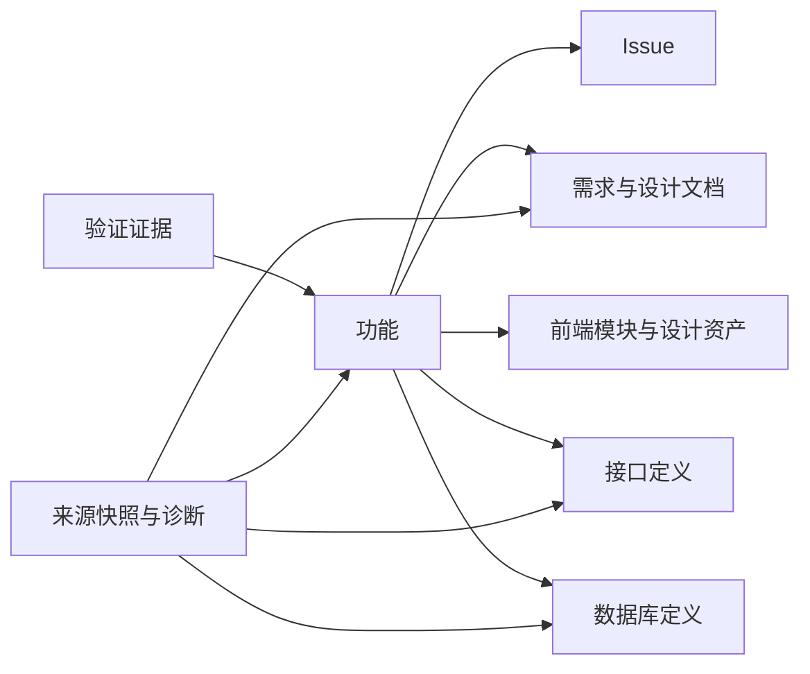

# Dev Portal 业务设计

> 状态：设计基线 v0.1，2026-10-10。本文描述待实现行为，不代表已有页面、数据源或运行验证。

术语见 [CONTEXT.md](../../CONTEXT.md)，地址与 URL 状态见 [导航矩阵](./navigation-route-matrix.md)，身份、来源和关联规则见 [资源设计](./resource-source-design.md)。

## 1. 产品定位

Dev Portal 服务于当前 TalosArk 仓库，帮助开发者回答：某个功能做到哪里，依据是什么，相关文件在哪里，设计、契约和实现是否一致。

主要使用者是项目维护者、功能贡献者和首次加入项目的开发者。使用者共享同一套本地只读能力；首版不区分角色权限，也不建立独立用户账户。

### 成功标准

1. 从一个功能入口找到它关联的需求、Issue、设计、前端、接口和模型；没有依据的关联明确为空。
2. 从搜索结果直接进入资源详情，并能看到来源位置与索引时效。
3. 在业务后端和数据库关闭时，仍能浏览仓库文档、结构、设计定义、schema 源码和已有契约。
4. 新增或修改仓库内容后刷新索引，页面显示一致的来源快照；失败时保留上次成功结果并标明过期。
5. 功能交付状态与来源故障分别呈现，不用漂亮的统计掩盖缺失数据。

### 基线与排除范围

- 本地单仓库，首版以文件读取、解析和只读聚合为主。
- 保留现有 tracker、设计 token、公开契约和数据库定义的真相源，看板不成为第二份业务数据库。
- 概览只显示可追溯摘要；不根据文件数量或提交次数生成百分比。
- 搜索、筛选、图谱定位、示例参数调整和索引刷新属于浏览交互。
- 任务创建与编辑、源码修改、真实 API 调用、SQL 执行、检查命令执行、部署和第三方写操作均不在首版范围内。
- 多仓库、团队账号、权限、AI 问答、代码生成和通用插件机制不进入本轮设计。

## 2. 信息组织

一级导航按开发者的工作对象组织：概览、项目进度、文档、项目结构、设计系统、数据库 Schema、API 与契约。

全局搜索始终可达，不占据一级侧栏项。数据源状态放在侧栏底部或全局状态入口，承担来源诊断和刷新职责。主导航下可以有页内视图，资源详情使用稳定 URL。

图中的连线表示有依据时可建立的关系，不要求每个功能具备全部资源。图谱缺少连接时不自动猜测归属。

## 3. 页面业务设计

| 页面          | 核心问题                     | 内容与交互                                                                  | 首版边界                                                       |
| ------------- | ---------------------------- | --------------------------------------------------------------------------- | -------------------------------------------------------------- |
| 概览          | 当前该关注什么？             | 仓库、分支与工作区状态；功能与 Issue 摘要；待补信息；来源异常；对应列表入口 | 无数据源时显示未配置或未收录，不能伪造零故障、完成率或趋势     |
| 项目进度      | 哪些功能正在推进，缺哪一层？ | 功能列表、看板、实现矩阵；功能详情；原始 Issue 状态、依赖和关联资源         | 所有视图使用同一数据集，只读；Issue 与实现程度分开             |
| 文档          | 如何找到并理解相关说明？     | 分类与路径目录、全文搜索、Markdown / Mermaid 预览、目录锚点、来源与关联资源 | 阅读仓库原文；不提供 Markdown 编辑、任意脚本执行或公开文档发布 |
| 项目结构      | 代码放在哪里，职责如何划分？ | 文件树、包依赖图、已确认模块视图；包、模块、文件详情；源码定位              | 模块关系来自入口与声明，不承诺任意代码的完整调用图             |
| 设计系统      | 规范和真实组件是什么样？     | 设计基础、组件目录、参数与示例、真实预览、规范和源码链接                    | 只列已收录组件和示例；预览不可用时仍保留定义与来源             |
| 数据库 Schema | 数据如何定义和关联？         | 模型 / 枚举列表、ER 图、字段、复合键、关系、索引与补充 DDL 浏览             | 默认是仓库定义；不连接业务数据，不执行同步、迁移或 DDL         |
| API 与契约    | 公开接口声明了什么？         | OpenAPI 操作列表、请求响应、错误说明、共享契约目录、源码和关联资源          | 接口操作与独立契约分开列出；无操作定义时不从契约虚构 endpoint  |
| 搜索          | 某个概念的资源在哪里？       | 按类型分组的结果、命中片段、位置和来源时效；跳转资源详情                    | 默认一次查询当前已发布索引；无命中与索引不可用分别说明         |
| 数据源状态    | 当前信息是否可信、如何更新？ | 数据源范围、上次成功时间、当前诊断、刷新状态、受影响页面                    | 仅刷新索引与查看诊断，不提供远程接入配置、凭据编辑或任意命令   |

### 概览摘要

概览最多突出三类入口：当前进行中的功能、需要补充信息的工作、读取或解析失败的数据源。每个计数必须带可进入的筛选列表；未知状态单独计数，不混入已完成或未开始。

展示 Git HEAD、分支和工作区是否有未提交内容，并显示索引生成时间。Git 信息不可读时保留来源诊断，不影响其他已成功读取的内容。

### 文档分类

分类包括指南、领域文档、设计、ADR、PRD 和其他文档。分类根据明确路径或声明决定；目录中的 Markdown 仅因存在标题，不能自动成为 PRD 或 ADR。

文档源为仓库文件；既有 VitePress 站作为可选预览或外部浏览入口。源文件与站点都存在时，标明各自更新时间，避免把较旧构建当成当前原文。

### 项目结构

包视图来自 workspace 配置和包清单，包含职责说明、脚本说明、包依赖及文档入口。脚本可复制，但首版不执行。

代码模块需要可识别的所有者入口或显式声明。首版支持模块定位、直接依赖和已声明职责；完整符号图、动态依赖分析、架构违规诊断放在后续评估。

文件详情显示相对路径、类型、源码与行号。搜索结果定位到指定行；重命名或删除后，旧链接显示资源已不存在，不映射到名称相似的文件。

### 设计系统

- Design Foundation、CSS token 和已有颜色样张作为初始来源；token 数值以 `packages/frontend/src/style.css` 为准。
- 前端提供独立真实预览入口或后续采用 Storybook；Portal 接入预览，避免导入业务应用启动流程。
- 每个组件显示可用的参数、变体、示例、状态与关联规范。暂未解析的属性标明未收录，不能把源码文本当成完整 Props 文档。
- 状态示例优先覆盖默认、Hover、Focus、Disabled、Invalid，以及组件自身已有的 Selected 状态。
- 色彩、字体、几何和动效分视图浏览；不默认开放主应用尚未支持的 Dark Theme。
- 示例参数调整仅影响当前预览，不能反写组件或 CSS；真实预览不可用时提供明确状态与定义入口。

### 数据库 Schema

Schema 页面合并查看 Prisma 多文件定义与原生 DDL，但保留各自来源。ER 图表现已解析的模型关系，并区分 relation field 与实际数据库列；复合外键保留整体关系。

原生 DDL 按 `init`、`schema`、`upgrade` 分类阅读。首版展示脚本原文、注释和显式关联，不承诺完整 SQL 语义解析，也不把升级脚本当成当前初始化步骤。

### API 与契约

OpenAPI 操作详情显示方法、路径、operationId（如有）、说明、请求、响应和认证声明。缺失的示例或错误说明保持缺失，不自动补造业务行为。

契约目录读取 `packages/contract` 的公开定义；源码浏览与结构化解析能力分别标注。业务后端的 `/api-doc-json` 与 `/reference` 是可选实时来源，Portal 自身接口不属于该目录。

## 4. 项目进度与实现程度

### Issue 生命周期

读取既有 tracker 的 `Status:`，沿用以下原始值：`needs-triage`、`needs-info`、`ready-for-agent`、`ready-for-human`、`in-progress`、`done`、`wontfix`。

不存在、无法读取或不符合已知词汇的状态记为 `unknown` 并附诊断，不能默认为未开始。`Blocked by:` 引用未解决 Issue 时，显示依赖阻塞信息；依赖环或失效引用显示诊断，不自行改写 Issue 状态。

### 功能生命周期

功能生命周期由所属 Issue 派生，按下列顺序判定；不修改 tracker，也不直接代表代码是否已验证。

| 功能状态      | 派生规则                                                           |
| ------------- | ------------------------------------------------------------------ |
| `untracked`   | 来源完整且无实施 Issue；可以已有 PRD 或资源关联                    |
| `wontfix`     | 来源完整、有 Issue 且全部为 `wontfix`                              |
| `unknown`     | 任一未排除 Issue 的状态未知，或 Issue 列表无法完整读取             |
| `done`        | 排除 `wontfix` 后至少有一个 Issue，且全部为 `done`                 |
| `in-progress` | 未完成集合中至少一个为 `in-progress`                               |
| `waiting`     | 未完成集合全部为 `needs-info` 或有未解决依赖，且没有 `in-progress` |
| `planned`     | 其余已知、未完成情况                                               |

如果展示任务完成比，仅计算 `done / 非 wontfix Issue 数`，同时显示分子、分母；存在未知状态或来源不完整时不计算比值。任务完成比不命名为“功能完成率”。

### 功能实现矩阵

矩阵按功能展示前端、接口契约、后端和数据库四个维度；需求、设计与验证证据作为关联列。没有数据库需求的功能可以明确标记不适用，不能被当成缺失数据库实现。

| 程度             | 含义                     | 最小依据                                                 |
| ---------------- | ------------------------ | -------------------------------------------------------- |
| `unknown`        | 尚无充分依据             | 无声明、关联缺失、来源异常或依据过期                     |
| `specified`      | 已有明确设计或契约       | 可定位的规范 / schema / 契约及显式声明                   |
| `mock`           | 仅具备演示实现           | 可定位的 mock / 示例及显式声明；只用于存在演示实现的维度 |
| `implemented`    | 已实现相应能力           | 显式实现声明与对应源码；文件存在本身不充分               |
| `verified`       | 相应能力有当前通过的证据 | 实现依据及与其检查范围匹配的通过证据                     |
| `not-applicable` | 当前功能不要求此维度     | 显式说明原因                                             |

矩阵默认不展示“未开始”推断；缺少记录统一为 `unknown`。`verified` 要求验证证据覆盖所声称的能力，例如类型检查通过不能单独证明完整业务交互已验证。

维度程度是对显式声明范围的判断，界面同时显示声明来源与覆盖范围。覆盖范围未确认时，以“局部已实现”等限定说明呈现已有程度；不能从一个已存在文件自动推断整个维度的程度，也不得用单个资源的通过结果替整个维度背书。

验证声明只有在必需资源覆盖范围已确认、依据有效且证据覆盖整个声明范围时才能显示 `verified`。刷新失败导致相关来源过期时，也撤销当前验证标记，保留历史依据。

### 证据与时效

证据至少包含检查名称、范围、执行时间、结果、版本依据和报告位置。首版只读取已有报告或声明，不自动运行检查。

检查结果区分 `passed`、`failed`、`not-run`、`unknown`；时效独立区分 `current`、`historical`、`unknown`。只有当前、范围匹配且通过的证据支持 `verified`。没有版本依据的通过报告仍可以阅读，但不能提升当前实现程度。

相关源码变化后，保留旧结果并标记历史证据；撤销当前 `verified`，按仍有效的实现依据显示程度，依据也失效时回到 `unknown`。旧检查失败显示在证据中，不因索引读取成功而消失。

## 5. 核心浏览流程

### 了解一个功能

项目进度 → 功能详情 → 查看 Issue 与实现矩阵 → 打开缺失维度或关联资源 → 查看原文与来源。跨页面使用正常路由历史，后退恢复原筛选和列表位置。

### 查找一个数据模型

全局搜索模型名 → 模型详情 → 查看字段、关系与约束 → 跳转 ER 图并聚焦该模型 → 打开 Prisma 或关联 DDL 源码。

### 检查组件效果

设计系统 → 组件目录 → 组件详情 → 选择已有示例与参数 → 查看真实效果 → 跳转规范或源码。预览服务不可用时，仍可浏览定义、示例说明和源码。

### 理解一个接口

API 操作目录 → 操作详情 → 查看请求、响应、认证与错误说明 → 打开关联公开契约及功能。仅有契约而无 operation 时，留在契约详情并说明尚未收录操作。

## 6. 交互与视觉原则

- 采用现有暖中性表面、清晰语义前景和高信息密度，优先沿用 Design Foundation；不在本文复制 token 数值。
- 壳层包含固定侧栏、上下文栏、页内导航与内容区；页面明确主滚动容器，图谱画布与源码面板可以拥有独立滚动。
- 当前一级入口由路由决定；页内视图、搜索和筛选由 URL 决定，临时弹层和拖拽状态留在本地。
- 列表主信息优先用行与分区呈现；资源详情展示标题、来源状态、内容和关联资源，避免嵌套摘要卡。
- 资源切换直接替换内容，不播放整页过渡。Focus、键盘访问、文字状态说明与 reduced motion 沿用现有规范。
- 宽屏允许目录 / 正文 / 关联信息三栏；较窄视口折叠辅助栏，手机优先阅读列表和详情，图谱提供列表替代，不在首版另建移动产品。
- Loading、无数据、无匹配、资源失效、部分解析、过期缓存和来源不可用必须有不同说明。

## 7. 技术与维护约束

前端沿用当前技术栈，按能力需要简化。Pinia 只承担共享可观察状态；筛选与页面视图不另存一份独立于 URL 的状态。

建议采用包内 Elysia + Node 仓库服务，承担读取、解析、缓存和索引通知，继续使用 pnpm。Elysia 的学习目标是本次选型理由之一；相比复用既有后端，需要额外维护框架依赖和接口说明。

降低贡献门槛的方法是把 Elysia 使用限定在服务入口和路由，解析逻辑使用普通 TypeScript 模块。业务包的日常开发和检查不依赖看板启动，不要求所有贡献者了解 Elysia。

看板服务不加载 NestJS 业务容器，也不要求 Prisma Client 生成或数据库连接。接口和组件实时预览不可用时，仅影响相关能力。

实现目录沿用 `layout`、`page`、`module`、`component`、`platform`、`shared`、`ui` 的单数命名与职责约定，按实际需要创建。看板私有的数据协议留在本包，不为此扩充业务 `@talos-ark/contracts`。

前端 API 浏览路由为 `/api`；看板服务统一使用 `/portal-api/*`。开发时由 Vite 代理，构建后由本地服务提供页面与接口。HTML history fallback 不处理 `/portal-api/*` 或静态资源失败，以免把接口 404 返回成页面。

不为本轮引入 Bun、Go、独立持久化数据库或通用插件平台。若未来需要将工具独立分发，再评估运行时与打包方式。

## 8. 阶段范围

| 阶段           | 内容                                                       | 完成条件                                         |
| -------------- | ---------------------------------------------------------- | ------------------------------------------------ |
| P0-A：浏览基础 | 壳层、路由、来源状态、文档、文件树、Prisma 模型与基础搜索  | 原文可定位，详情可直达，来源异常可解释           |
| P0-B：资源关联 | 功能与 Issue、实现矩阵、包与模块、设计资产、API 与契约     | 可沿一个功能浏览所有已确认关联，状态有依据       |
| P0：首版整体   | 七个主入口、搜索与来源状态全部具备真实读取或明确不可用状态 | 满足下列首版验收；不以空页面骨架代替交付         |
| P1：开发反馈   | 变更关联、质量状态、开发环境导航                           | 各自有来源、版本与可核对结果；命令执行需单独设计 |

P0-A 与 P0-B 是实施顺序，不改变首版整体范围。P1 导航与路由仅作为后续规划，首版不注册或展示空占位入口。

## 9. 首版验收场景

1. **首次打开**：展示真实仓库身份和已收录来源；tracker 为空时显示没有已收录功能，不生成示例项目进度。
2. **深链接**：任一资源详情刷新后仍能打开；前进、后退恢复视图、搜索、筛选、锚点和列表滚动。
3. **功能有 mock**：前端维度显示 `mock`；接口契约存在不能使后端维度变为已实现；没有证据不能显示已验证。
4. **功能无数据库需求**：显式 `not-applicable` 与未确认的 `unknown` 有不同说明。
5. **任务与验证不一致**：Issue 全部 done、检查尚未执行时，生命周期可为 done，矩阵仍保留未验证程度。
6. **后端关闭**：文档、结构、Prisma 和已收录契约可用；无可用 OpenAPI 快照时仅操作目录显示来源不可用。
7. **多文件 schema**：模型与枚举覆盖配置中的当前模型文件，复合关系可定位；原生 DDL 有独立来源与生命周期分类。
8. **组件预览关闭**：详情保留真实定义和来源，预览显示不可用；不渲染自制替代效果冒充真实实现。
9. **刷新失败**：保留上次成功快照，明确过期原因；关联结果不混用新旧快照，重试成功后统一更新。
10. **来源失效**：删除文件或关联对象后，诊断保留可读说明；失效资源不继续计为已实现或已验证。
11. **搜索定位**：结果进入正确资源详情并定位行或锚点；未知资源、未知路由、无搜索结果分别呈现。
12. **只读约束**：看板操作不改 tracker、源码、设计 token 或业务数据库；浏览脚本与 DDL 不会执行它们。

## 10. 已有仓库依据

- [前端技术栈](../../../frontend/package.json)、[前端职责与命名约定](../../../frontend/CONTEXT.md)。
- [Design Foundation](../../../frontend/docs/design/design-foundation.md)、[UX 规范](../../../frontend/docs/design/ux.md)、[token 来源](../../../frontend/src/style.css)。
- [Issue tracker](../../../../docs/agents/issue-tracker.md)、[生命周期词汇](../../../../docs/agents/triage-labels.md)。
- [公开契约职责](../../../contract/README.md)、[OpenAPI 生成入口](../../../backend/src/bootstrap/bootstrap.ts)。
- [Prisma 配置](../../../backend/prisma.config.ts)、[原生 DDL](../../../backend/prisma/ddl/README.md)。
- [Elysia Node 集成](https://elysiajs.com/integrations/node)、[Eden 类型协作](https://elysiajs.com/eden/overview)。这些是选型参考，不代表首版已采用 Eden。
