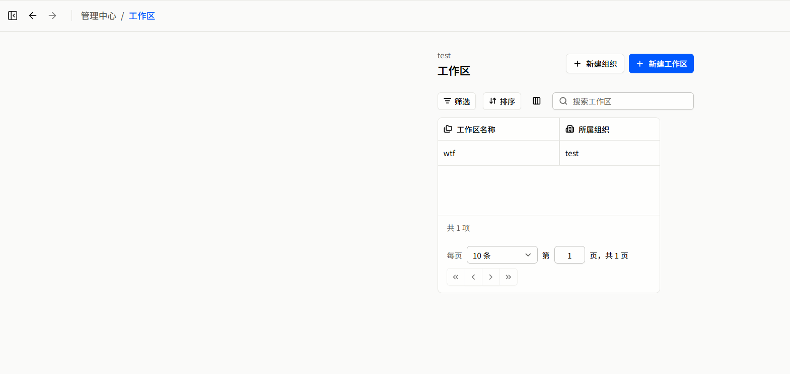

# 前端全量整改计划书

建立日期：2026-10-15；状态校准：2026-10-23。性质：持续维护的整改任务书；历史基线与当前实施状态分开记录。

**当前进度、已关闭旧缺口与未签收项统一见 [状态台账](status-ledger.md)。** 当前已推进到 R08-A/B/C 可实施项；R07、P14–P18 与深色主题按用户决定暂缓。R09 可先验收现有 P01–P13 范围，不必先修复将在后续重建的旧测试基线；本次仅校准文档，没有新增业务验收结论。

实施记录：[R00 基线](baseline/README.md)、[R01 首轮](r01/README.md) / [返工](r01/revision/README.md)、[R02 管理列表](r02/README.md)、[R03 对象上下文](r03/README.md) / [问题复验](r03/acceptance-2026-10-18.md)、[R04 管理剩余页](r04/README.md)、[R05 资源主链](r05/README.md)、[R06 资源深页](r06/README.md)、[R08 全局与认证](r08/README.md)、[R10 工作台](r10/README.md)。

**实现、隔离验收、本地真实联合验收与全量签收不是同一状态。** R01 完整视觉门禁、R04 无生产来源的子包、R08 真实身份/平台等边界仍保留；P08/P09/P10/P11/P12/P13 的已有本地真实证据在状态台账分别索引，不能继续把旧“待接入/未验收”总结当作当前状态，也不能把旧证据自动扩展到后续改动。

R10 是补入的工作台执行包，不重编号既有 R00–R09。资源概览与 P12 审批队列已真实接入；普通任务与异常提醒仍随 P15/P16，部分接入不代表整个 P17 完成。

## 1. 结论与责任

初始审查发现前端没有达到设计稿所表达的信息完整度、排版质量和操作连贯性，先前交付对 UI 的逐页落实不够细，管理中心尤为明显。以下整改标准继续有效，但这段不是对当前版本重新执行视觉验收的结论：不能把“接口接通”“存在路由”“表格能显示两列”算成页面完成。

用户认可的 `/main/workbench/overview` 是本次整改的最低质量参照，保留其现有构图。其他页面必须逐页验收，不能仅通过替换公共容器就宣布全站完成。

**本文中的目标不自动代表代码已经存在或批准新的业务规则；当前进度以状态台账及其引用的实施、验收记录为准。原始页面问题保留为整改前基线，不作为今天仍未实现的证据。**

## 2. 资料与核查口径

已逐张查看 [71 张冻结稿](../../../../../output/design/frozen-v2-71-2026-09-29/index.html)：A 组 4、B 组 11、C 组 9、D 组 9、E 组 11、F 组 15、G 组 12。逐页意见见下列七份分册，另覆盖未单独出稿的现有页面和状态。

这些设计原图目前位于本地 `output/design`，不在 Git 跟踪内。当前工作区中的其他 agent 可直接打开；跨机器/仅仓库交接时必须额外交付该冻结目录及 REVIEW-NOTES，不能把 Markdown 链接当成原图已经随仓库交付。接手者拿不到图时须先取得原图，不按文字脑补。

- [设计基础](../../design/design-foundation.md)：当前设计系统；实际数值以 `src/style.css` 为准。
- [交互约定](../../design/ux.md)、[管理骨架历史记录](../../design/management-skeleton.md)、[前端上下文](../../../CONTEXT.md)：说明已有选择，但其中早期“全 Mock”“标题栏不被遮罩”等说法不能覆盖当前实现和用户后续决定。
- [冻结稿说明](../../../../../output/design/frozen-v2-71-2026-09-29/README.md)、[已知稿件问题](../../../../../output/design/frozen-v2-71-2026-09-29/REVIEW-NOTES.md)：生成稿并非全部经过视觉验收，不能机械照抄。
- [MVP 工作安排](../../../../../docs/product/mvp-work-plan.md)、[范围](../../../../../docs/product/mvp-scope.md)：业务切片边界；当前主线已到 P13，具体能力与验收边界以任务表、实施记录及用户决定为准，不因后续计划存在就视为已授权开发。
- 初始审查核查了路由、页面、布局容器、DataTable、团队管理、工作区切换器、命令面板等源码。**当时是逐图与源码审查，不是对 71 个运行页面的浏览器验收。** 用户截图是整改前工作区列表的直接运行证据；后续实现和浏览器证据分别见各包记录。

### 文档入口

| 文档 | 内容 |
| --- | --- |
| [status-ledger.md](status-ledger.md) | 当前包状态、已关闭旧缺口、证据索引、延期与未验证边界 |
| [foundation.md](foundation.md) | 根因、画布宽度、布局、颜色、组件边界、通用交互与验收门禁 |
| [page-a.md](page-a.md) | 工作台 4 张稿及独立异常提醒页 |
| [page-b.md](page-b.md) | 材料 11 张稿、材料 7 个子视图、Bank 与 Batch |
| [page-c.md](page-c.md) | 库存 9 张稿、位置浏览、盘点流程 |
| [page-d.md](page-d.md) | 设备 9 张稿、遥测/操作的延期边界 |
| [page-e.md](page-e.md) | 管理中心 11 张稿，重点是工作区 6 个详情视图 |
| [page-f.md](page-f.md) | 权限、设施、集成、审计等 15 张稿 |
| [page-g.md](page-g.md) | 12 个跨页面浮层和操作流程 |
| [additional-surface.md](additional-surface.md) | 原始 45 个叶子路由覆盖表、认证/启动/账户/无稿状态、实施检查表 |

## 3. 整改前工作区页面的问题（历史基线）

本节描述 2026-10-15 的问题与原因。R02/R03 已补管理列表和真实对象详情，不再以本节的“只有两列/没有详情路由”列为当前待开发项。

用户指出的 E-04 是“工作区详情·概览”；当前截图是 E-03 对应的“工作区列表”。**这不是用户记错的问题，而是当前列表压根没有把用户带进 E-04 的完整对象上下文。**

E-03 要有工作区名称与说明、所属组织、负责人、成员数、资源数、状态、最近更新和操作入口。当前只有名称与组织两列。E-04 还要求对象头、六个详情标签，以及基本信息、资源统计、成员概况、最近活动、使用趋势五块内容；后续 E-05 至 E-09 分别展开成员、角色、资源、共享、设置。当前没有这套详情路由。

以下是整改前基线的确定源码原因，历史描述不代表返工后的源码：

| 位置 | 当前实现 | 后果 |
| --- | --- | --- |
| `src/page/management/Workspace.vue` | 仅 220px 名称列 + 180px 组织列，无详情动作 | 业务缺失，并把表格本征宽度缩至约 402px |
| `src/page/management/component/ManagementPage.vue` | table 布局使用 `w-fit`，内部 `min-w-0` | 整个标题、工具栏、表格画布随内容收缩；没有可读宽度约束 |
| `src/component/data-table/layout/useTableLayout.ts` | frame 宽度为列宽和 + 2px | 表格保持列宽本身合理，但不能反向决定整页宽度 |
| `src/component/data-table/DataTable.vue` | 工具栏只有 maxWidth，页脚允许换行 | maxWidth 并非 minWidth；窄画布把按钮、搜索、分页挤成多行 |
| `src/layout/shell/AppDesktopShell.vue` | 业务外壳有 `min-w-4xl` | 外壳最小宽度不能代替正文画布最小可用宽度 |
| `src/page/resource/ResourcePage.vue` / `ResourceDetailPage.vue` | 列表/详情也出现 `w-fit` | 同类风险不只在工作区页，须回归全部业务页面 |

因此，整改必须同时做“稳定正文画布”和“恢复真实业务信息架构”，只给两列表格加宽不能算解决。

用户提供的整改前运行截图已归档，作为 R01/R02 的对照证据：

## 4. 实施边界与标记

以下标记在各分册统一使用：

- **即修**：主要依赖现有前端/契约，可立即整改布局、导航、文案、已有流程。
- **接线**：已有相应真实后端能力，但需要核对字段、权限、分页、状态并完成前端接入；“有模块”不等于该页面所有字段都已有。
- **契约缺口**：当前前端没有可证实的数据来源，列出需要后端提供的读模型或命令。前端 agent 不擅自新增业务 API、不猜权限。
- **阶段保留**：设计中应保留的产品能力，但不在当前已批准的软件切片内；例如实时硬件控制。不因延期从整改清单消失，也不把空壳算完成。

主线已交付到 P13：认证/组织与团队基础之外，材料、设施位置、库存流转、附件、固定审批和限定批量操作已有真实接线及各自验收记录；通知、普通任务、盘点等仍按延期范围单列。**禁止生产路径回退为演示数据、随机图表或模拟组织。**

没有接口时，先在隔离的预览/验收环境完成视觉设计；生产入口只显示准确、克制的可用性说明或不开放入口。不得满屏放“尚未接入 + 灰按钮”来冒充成品。是否隐藏一个现有入口需要用户确认，不由本计划偷偷删除。

## 5. 执行顺序

| 包 | 先做什么 | 文件范围/依赖 | 交付与通过条件 |
| --- | --- | --- | --- |
| R00 基线 | 固定当前 HEAD，截取认可的工作台与问题页；建立页面/状态台账 | 本目录、冻结稿、现有路由；不改业务 | 每个页面有设计 ID、源码、当前截图或明确“未实现”，不以 Mock 充当真实验收 |
| R01 公共视觉基础 | 先完成 E-03、E-10、B-04 代表页的现有内容排版；同时修 E-01 主辅构图、复验 A-01/A-03，再推广公共布局 | 页面构图及 ManagementPage、ResourcePage、ResourceDetailPage、DataTable 的最小布局扩展；不补接口/对象路由 | 逐页记录设计区域、保留/适配/缺口；标题/动作/工具栏/表格对齐，摘要与主辅区有层级；0/1/长名/最小列集合稳定；1024-2560、125% 和关键交互有证据或逐项未通过，不能仅据 CSS/构建签收 |
| R02 真实管理列表 | E-03、E-10、F-01；统一团队管理信息层级与现有操作 | Workspace、Member、Role、TeamManagement，P04/P06 契约 | 列表可读、操作有上下文、权限不变、创建/邀请/角色写入后同步失败不重复提交 |
| R03 对象上下文 | E-04..09、E-11、F-02 的路由/对象头/本地导航 | 生产已切换真实 HTTP，原型仅保留显式入口；见 R03 真实接入补充及复验 | 真实详情读写已有定向检查，两项验收问题已修复；完整身份/外部认证邮件/平台等边界仍保留 |
| R04 管理剩余页 | E-01 的聚合/活动数据及 E-02、F-03..15，拆为 A 审计、B 组织、C 授权共享、D 设施、E 通知、F 配置集成 | [分步计划](r04/README.md)；F-09/10 硬件联动仍为下一阶段 | A1/B/C/E/F 已交付只读前端与隔离验收；D 已接 P08，2026-10-22 本地真实 Web/HTTP/数据库验收通过；其他子包的生产契约缺口仍保留 |
| R10 工作台专项（优先插入） | A-01/A-03/A-04/A-X；独立加载资源概览及已落地队列 | [专项计划](r10/README.md)；A 已复用 P07–P09，B 已接 P12，普通任务/提醒仍依赖 P15/P16，统一交接 P17 | A 的只读/隔离与 P12 审批真实定向证据已有；普通任务/异常不显示虚假零值，当前全域联合门禁尚未全部签收 |
| R05 资源主链 | B-01/02/04/05、C-01/02/03/04/08/09、G-05/07/09 | P07–P11 现有能力的页面质量；G-09 单件转移已有 P11 实现与真实验收 | 当前契约内页面已整改并隔离检查；[未签收项](r05/README.md) 单列，真实业务引用原证据，不以 Mock 替代 |
| R06 资源深页 | [实施与分组](r06/README.md)、[重审与隔离验收](r06/audit-2026-10-21.md)；B-03/06..11、C-05..08、G-06/08 | 普通 Batch 库存与 P10 分片恢复已重审；P10 于 2026-10-22 补齐本地真实 UI/存储验收；P12/P13 固定审批及限定批量能力已交付 | 培养/谱系/QC、盘点、提醒及其他领域缺口分组保留；部署/清理/平台仍待验，隔离结果不冒充真实证明 |
| R07 设备 | D-01..09、F-09/10、G-10 | 本包按用户决定暂缓；遥测/控制仍为下一阶段 | 恢复推进时区分离线/未知/过期数据，绝不显示假在线或把请求接收当执行成功 |
| R08 全局与认证 | [分包与实施](r08/README.md)；A 认证恢复、B 全局入口、C 业务浮层 | R07 暂缓不阻塞；P14–P18 依赖单列 | A/B 及 C 可实施项已通过隔离 Web 验收；G-12 多候选、日期复合筛选与真实认证/权限/平台仍待验，不按整包真实验收通过 |
| R09 整体验收 | 可先复查现有 P01–P13 页面、状态与权限；延期范围明确排除 | 本目录检查表；不大改架构、不以重建测试基线为启动前提 | 当前尚未执行整包；逐页视觉 + 已批准业务闭环分别签收，不能把局部证据或文档校准当成发布通过 |

R01 不应演变成“重写整个表格”；R03 不应演变成“先造通用对象详情平台”；R04 不应为了填图表而抢做完整后端基座。每包先挑一个代表页完成，再推广到同类页面。

### R01 与后续包的交界（2026-10-16 修订）

原安排把公共尺寸和页面构图分开得过细，容易出现“容器已修好、页面仍没有层级”的交付。R01 必须完成现有内容的可用构图，不能把全部视觉责任推给 R02/R04。

- **R01 现在就做**：已有名称/说明/ID 的身份层级、页面动作主次、工具栏与表格同宽、有限摘要宽度、主辅比例、窄宽度退化、现有成员表的扫描与溢出处理。字段、命令和查询语义不变；可展示已经存在但此前未呈现的说明/ID，不虚构统计。
- **R02 才做**：团队列表整合、服务器查询/分页衔接、按权限注册行操作、缺失字段的契约核对。不能把 R01 的样式补齐记作 R02 已完成。
- **R03/R04 才做**：缺失对象路由及详情读模型、管理概览聚合/审计/趋势等真实能力。R01 提前整理 E-01 构图，不生成假图表、假总量或新接口。
- **验收分开**：尺寸正确、视觉构图、真实数据、权限分别记录；“未验证”和“有缺口”不能自动通过。未完成门禁的 R01 只能标为待验收，后续包不得把它当已通过基线。

## 6. 接手 agent 的交付要求

1. 实施前读本入口、foundation、对应分册、当前 CONTEXT 与业务契约。发现本计划与新提交冲突，写清调整理由，不静默改规则。
2. 每个实施包提交页面对照：设计图、改前、改后，同一视口与相近数据密度。至少一张整页与一张关键操作状态截图；E/F 不能只交公共容器截图。
3. 每页记录“视觉已验收 / 真实数据已接入 / 权限已验证 / 延期项”，分别给证据。构建通过不是 UI 验收，静态预览不是业务闭环。
4. 新增字段逐项核对契约；例如负责人、成员数、资源数、审计、使用趋势没有接口就列依赖，不拿可见数组长度猜组织总量。
5. 保留现有认证、工作区隔离、权限和事务后同步语义。需要改变业务流程、API、现有路由语义或删除入口时先说明并确认。
6. 优先沿用 `ui/`、`component/`、领域 `module/`，维持单数命名与静态路由导入。没有请求不新增长期测试框架；必须做浏览器视觉和关键行为验收，可用一次性探针。
7. 只修改对应前端范围；后端契约需求以明确清单交给后端 agent，不用视觉任务夹带后端重构。
8. 图片批量浏览仅用于总览。实施与验收必须一次聚焦一张代表图，记录区域、比例、字段层级、动作、状态及当前系统的适配理由；关键细节必要时单独放大。每个代表页先做同视口、相近密度的设计/改前/改后对照，再推广，不能一口气看十几张缩略图后宣布逐页核对完成。

## 7. 计划与实施的完成标准

计划本身须覆盖全部 71 个稿件编号、原始 45 个叶子路由及后续新增路由、已知多视图和关键浮层；每个页面必须有具体整改意见，而非“优化一下”。实施按包另行记录，完成计划不代表完成代码整改，也不代表浏览器验收通过。R01 的当前结果及未通过门禁以返工记录为准；后续推进按当前状态台账区分已实现、已验收、未验证与延期。
