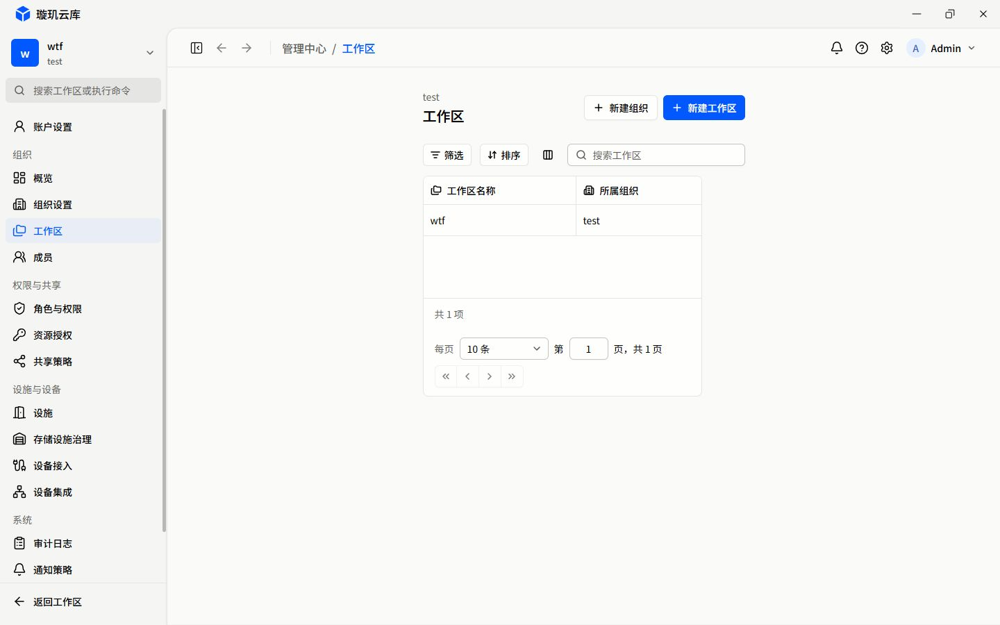
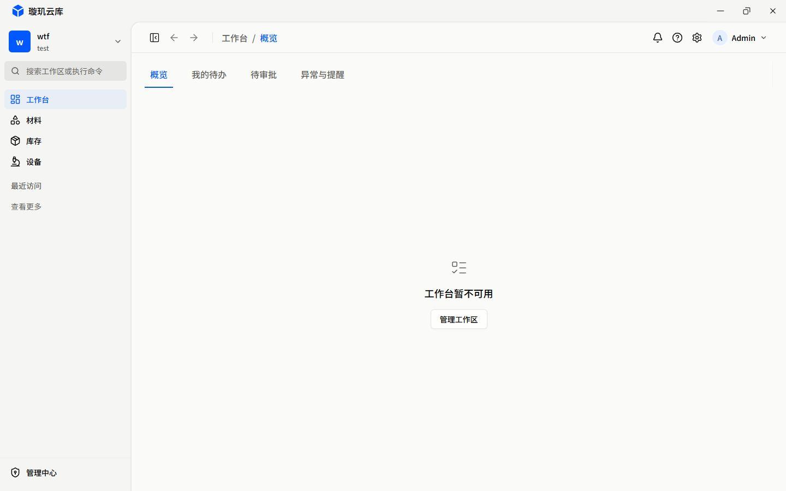
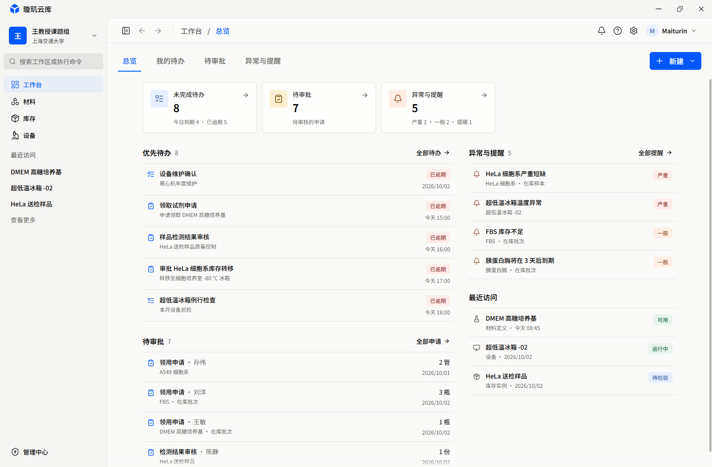

# R00 整改前基线

归档批次：2026-10-15；收尾复核：2026-10-16（Asia/Taipei）。执行范围：仅 R00，不包含 R01 公共布局整改。

## 固定点

| 项目 | 记录 |
| --- | --- |
| 基线提交 | `ce2f8d8fa38ba9d9721ea1160eff3d8d541a972c` |
| 开工工作区 | `git status --short` 仅有未跟踪的 `packages/frontend/docs/remediation/`；源码无本地修改 |
| 运行入口 | 已运行的 `http://localhost:4444`，Codex 内置 Chromium 浏览器 |
| 主视口 | 1440 × 900 CSS px，DPR 1，明亮主题，侧栏展开 |
| 数据条件 | 沿用已登录本地会话；当前组织一个工作区，组织成员列表一条、角色列表三条；只是本次可见结果，不代表全平台总量 |
| 采集方式 | 只读导航及打开/关闭现有浮层，不创建记录、不提交表单、不切换组织/工作区、不修改权限、不启用 Mock |
| 证据类型 | 浏览器当前截图、历史构图参考、源码核查分别标注，不混作真实业务验收 |

本轮没有修改 `src/`、后端、API 契约、路由、依赖或测试配置，也没有新建分支/提交。没有启动或停止用户的服务。

## 交付索引

- [页面台账](page-ledger.md)：45 个当前叶子路由，逐项关联设计编号、源码、当前截图或正常对象态阻塞。
- [设计覆盖](design-ledger.md)：71 个冻结稿编号，关联当前入口；未实现的页与流程明确登记。
- [状态台账](state-ledger.md)：本地标签、跨页状态、权限/异常、后续视口和表格回归要求。
- [截图清单](manifest.json)：实际文件尺寸、SHA-256、文件时间及路径；不保存 Cookie、令牌或原始认证日志。

默认 `*-current.jpg` 是 1440 × 900 的当前运行截图，不是改后图。`e-03-1024/1280/1920/2560.jpg` 是同一工作区、同一条记录的不同宽度截图；`x-01-390.jpg` 是 390 × 844 的认证窄窗口截图。主区使用内部滚动，整页截图不等于展开了每一个内部滚动区域。

## 两个关键对照

### 工作区问题页：当前可复现

在当前真实一条记录下，只有“工作区名称/所属组织”两列。表格约 402px，标题、工具栏与正文画布收缩，分页多行；没有进入完整工作区详情的动作。原计划中的[用户截图](../e-03-before.png)保留不动，本次截图是另一个明确尺寸的运行对照，不声称两者数据/视口相同。

复现：保留当前组织/工作区和默认列宽，打开 `/main/management/workspace`。R01 对齐/宽度/页脚整改后使用相同 1440 × 900 视口及相近数据密度对比；E-04..09 的业务缺项另归 R03，不能用加宽冒充完成。

### 工作台：保留构图，不伪造正常数据态

当前页显示“工作台暂不可用”。源码核查：[main.ts](../../../../src/main.ts) 仅注入 account/workspace/team 数据源，[bootstrap.ts](../../../../src/bootstrap.ts) 仅在提供 workbench 数据源时连接并加载；当前没有提供该源。因此有登录会话和工作区，不代表工作台 reader 已接通。A-03/A-04/A-X 同样被此状态挡住。

该图从本机已有 `output/qa/overview-1600.png` 原样复制，1600 × 1050。可见三项摘要、左侧待办/审批、右侧异常/最近访问，与用户要求保留的操作队列构图相符。**仅用于历史视觉参考**：其记录、数字、权限及截图对应提交没有重新核实，不是当前 HEAD 的正常数据态，也不是本次新增的视觉签收。冻结 A-01 是另一类设计参考，不覆盖当前获认可的构图。

解除正常态取证阻塞需要可用且合法的工作台 reader/记录；不为截图将演示数据接回生产入口。当前不可用态的基线已留存，正常态运行回归仍需补充。

## 后续实施须遵守的差异

| 差异 | R00 处理 / 后续约束 |
| --- | --- |
| B-03 计划建议独立培养物列表 | 用户已要求删除独立培养物页，采用“生物材料”分支及其专业能力；本轮登记冲突，不恢复 `/main/material/culture` |
| 库存列表宽度 | 用户明确要求去掉库存列表最大宽度限制；foundation 的普通画布 1200px 不得机械覆盖此特例，R01 应明确宽表例外 |
| 冻结稿中的管理中心二级侧栏 | 以当前已确认的主侧栏分页方案为准，不恢复常驻第二侧栏 |
| 冻结 A-01 资产统计构图 | 保留当前已认可的工作队列构图，不换回假指标/随机图表 |
| 标题栏、资源预览、页面动画 | 保留现有窗口控件层级、Sheet 预览和已移除详情路由淡入淡出的决定，不按旧设计说明倒退 |

这不是批准新增业务能力。缺少源对象的详情骨架、未实现流程、未批准聚合范围，均在台账中保持阻塞/未开始。

## 完成边界

R00 资料归档：**待验收**。已建立 71 个稿件、45 个路由及关键状态的覆盖台账，38 个非参数化叶子页面有当前截图，7 个参数化叶子详情记录了缺少合法对象/数据来源的阻塞；另有浮层和多尺寸基线。正常工作台取证仍阻塞，不将历史样例当真数据通过。

本轮仅核查页面可达、当前状态与证据完整性，没有验收写入闭环、权限矩阵、拖拽/缩放全部交互或失败恢复。未运行构建、类型检查或业务测试，因为没有运行时代码变更。后续 R01/R02 仍须按原门禁执行并提供改后证据。

## 收尾校验

- TypeScript AST 对照路由台账：45 个叶子路由完全匹配，无遗漏/重复，其中 7 个参数化详情。
- 设计 manifest 对照：71 个编号全部覆盖，无遗漏/重复。
- 四份基线 Markdown 的本地链接存在性检查：199 个目标，未发现失效链接。
- 图片解码、尺寸与哈希检查：50 份图像证据，共 49 张当前运行截图及 1 张历史参考；其中 38 张当前叶子页、6 张浮层、5 张额外视口。清单记录真实尺寸，不把 DPR 当缩放。
- 主源码提交仍为固定 HEAD；源码/依赖无本轮修改。临时采集标签页已关闭，用户原有标签页保留，未变更业务数据或持久侧栏偏好。

这些校验只证明基线资料的一致性，不能代替产品视觉签收、接口正确性或权限验收。
