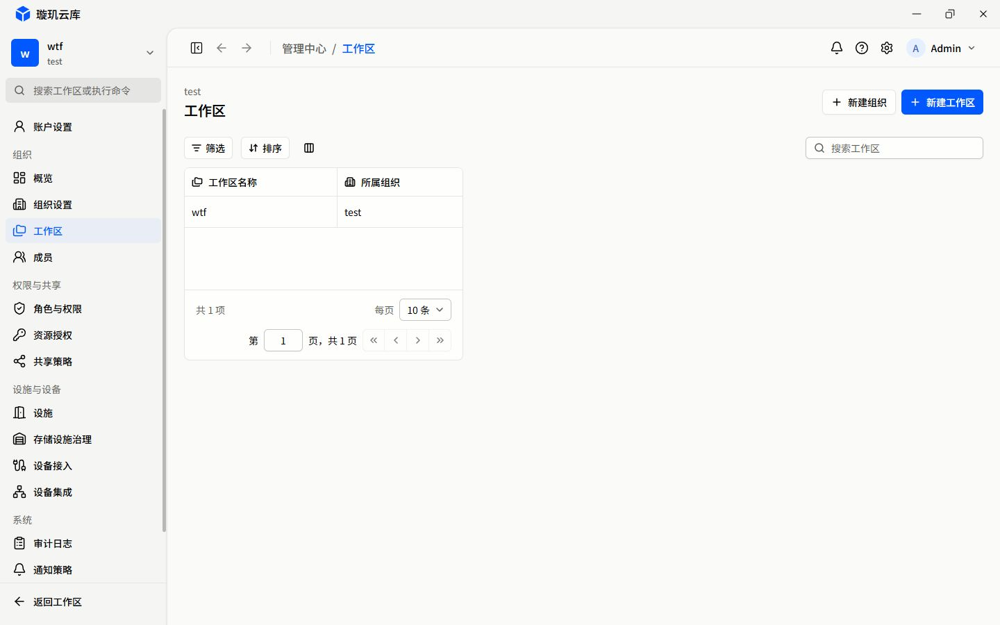

# R01 公共布局实施记录

> 此文保留首轮结果。2026-10-16 用户指出构图交付不足后，R01 已返工；当前范围、实现和未通过门禁见 [返工记录](revision/README.md)。不能继续以本轮尺寸检查代表 R01 视觉签收。

实施日期：2026-10-16（Asia/Taipei）。对照提交：`ce2f8d8fa38ba9d9721ea1160eff3d8d541a972c`。

**状态：实现已落地，代表场景已核查，完整验收待补。** 本轮不是 R02 管理业务补全，也不代表 45 个路由逐页签收。

## 修改内容

- 普通管理/资源画布采用 `w-full`、1200px 上限，详情正文 1280px、工具工作区 1440px、表单 720px。内边距为 16px，桌面 lg 起为 24px。
- 库存列表保留用户要求的全可用宽度，不设最大宽度。详情对象头与标签仍在满宽顶部区域，不受正文画布影响。
- 工作台三张列表、材料列表/概览移除随表格固有宽度收缩的画布；认可的工作台 Overview 构图源码未修改。
- DataTable 工具栏不再按列宽和限宽，以自身可用宽度为准；不足 600px 时搜索进入整宽第二行。
- 分页按表格框宽度布局，总数/容量与页码/翻页分别成组；常规宽度同排，窄框分组换行，极窄框使用紧凑纵排。页脚不脱离表格、不通过拉伸列来塞下分页。
- 管理概览残留的 `w-fit` 区块改为稳定全宽，避免 inline-size 查询容器令其按标题缩窄。资源详情主辅区与事实列表在自身正文宽度不足 1000px 时单列。

未修改列宽模型、分页行为、筛选/排序语义、拖拽算法、原生 X / ScrollArea Y 组合、cell 边框、操作列渐隐、认证、数据源或权限；无新增依赖。临时隔离预览入口已删除，没有接回生产 Mock，也没有新增长期测试脚本。

## 同视口对照

E-03：两图均为 1440 × 900、展开侧栏、同一组织的一条工作区记录。页面画布由随内容缩小变为 1151px；表格仍保留 220px + 180px 的两列，而不是造空白列或拉伸它们。

| 整改前 | 整改后 |
| --- | --- |
| [R00 工作区截图](../baseline/e-03-current.jpg) | [R01 工作区截图](e-03-1440-expanded.jpg) |
| [R00 成员截图](../baseline/e-10-current.jpg) | [R01 成员截图](e-10-1440.jpg) |
| [R00 角色截图](../baseline/f-01-current.jpg) | [R01 角色截图](f-01-1440.jpg) |

工作区的缺失字段和详情入口仍归 R02/R03，不能把这张窄表格理解为完整 E-03 业务已完成。成员/角色仅验证公共画布，没有替换其专有列表或改变真实命令。

## 实际页面验证

使用已运行的 `http://localhost:4444` 和既有登录会话，明亮主题、DPR 1；未创建/修改业务记录、未切换组织或工作区、未修改权限。仅临时切换侧栏，完成后恢复展开并关闭采集页。用户原有标签页保留。

| 视口 | E-03 展开侧栏画布 | 收起侧栏画布 | 页面/页脚横向溢出 |
| --- | --- | --- | --- |
| 1024 × 768 | 735px | 919px | 均为 0 |
| 1280 × 800 | 991px | 1175px | 均为 0 |
| 1440 × 900 | 1151px | 1200px | 均为 0 |
| 1920 × 1080 | 1200px | 1200px | 均为 0 |
| 2560 × 1440 | 1200px | 1200px | 均为 0 |

对应文件为 `e-03-{宽度}-{expanded|collapsed}.jpg`。实际工作区搜索无结果时，画布不变，空态填满 135px 记录视口，见 [筛选空态](e-03-filter-empty.jpg)；这不是无组织状态。

| 页面 | 2560px 视口的正文宽度 | 证据与限制 |
| --- | --- | --- |
| 成员 E-10 / 角色 F-01 | 1200px | [成员](e-10-2560.jpg)、[角色](f-01-2560.jpg)；只读既有记录 |
| 材料列表 B-02 | 1200px | [截图](b-02-2560.jpg)；当前 reader 未提供资源，不算材料真实数据验收 |
| 库存列表 C-02 | 2271px，max-width 为 none | [截图](c-02-2560.jpg)；保留宽表例外，列不自动铺满 |
| 存储浏览 C-03 | 1440px | [截图](c-03-2560.jpg)；当前节点未加载 |
| 账户资料 X-08 | 720px | [截图](x-08-2560.jpg)；未提交资料更改 |

[管理概览截图](e-01-1440.jpg)补查了残留 shrinkwrap 调用方：画布 1151px、表格 942px，起始对齐且页面无横向溢出。DOM 测量汇总见 [metrics.json](metrics.json)，图片尺寸/哈希见 [manifest.json](manifest.json)。

## 隔离布局验证

使用一次性独立入口、新 Pinia 和显式 mock 适配器，仅复用当前组件。以下均为**隔离视觉/交互证据，不是生产数据、权限或写入验收**。

| 条件 | 实测结果 | 证据 |
| --- | --- | --- |
| 0 / 1 / 2 条记录 | 画布均 1152px；记录视口 171px = 3 × 57px，无额外纵滚；空态高 171px | [0 条](isolated-empty.jpg)、[1 条](isolated-one.jpg)、[2 条](isolated-two.jpg) |
| 10 条长中文名称/多行内容 | 画布不缩小；行高 65px，超出记录区时局部纵滚 | [长名称](isolated-long.jpg) |
| 100 条、页容量 100、父高 360px | 100 条挂载；表头底与记录区顶均为 226px，记录视口 217px、scrollHeight 5700px；页脚保留 | [100 条](isolated-100-constrained.jpg) |
| 表格调用区宽 320px | 工具栏变为 76px 两行，分页无横向溢出 | [窄容器](isolated-narrow.jpg) |
| 全部业务列隐藏，仅选择/操作列 | 框宽 190px，页脚宽/scrollWidth 均 188px；紧凑纵排可完整显示 | [最小列集合](isolated-actions-only.jpg) |
| 调宽后横滚 | 名称列从 280px 调至 512px；1024px 视口内原生 X 的 scrollLeft = 426 = 1160 - 734，能到最右端 | metrics.json 的 resize 项 |
| 表头换位，光标释放于表体 | 宽名称列跨过组织列，释放后 DOM 顺序为组织、名称、编号、状态 | metrics.json 的 drag 项；未据截图声称所有拖拽动画已签收 |
| reduced-motion | 页面、原生 X、记录区 Y 的 computed scroll-behavior 均为 auto | metrics.json 的 reducedMotion 项 |
| 材料详情与本地标签切换 | 1920px 视口内对象头占可用 1680px、正文 1280px，无页面横向溢出 | [概览](isolated-material-overview.jpg)、[实例与库存](isolated-material-instance.jpg) |
| 工作台 Overview | 复用原组件，画布 1200px、原队列构图保留 | [隔离工作台](isolated-workbench.jpg)；不等于真实 reader 回归 |

极窄分页增加表格最小总高度，父级若硬限制为低于 header + minRows + footer 的高度，仍需允许外层滚动；本轮不破坏原有最小行数契约来强行塞入不可用空间。

## 静态验证

| 项目 | 结果 |
| --- | --- |
| `pnpm --filter @talos-ark/frontend type-check` | 通过；构建还再次运行 vue-tsc |
| 根目录 `pnpm exec eslint <本轮 Vue 文件>` | 通过；前端局部旧 shim 指向已不存在的 ESLint 10.10，改用根目录当前安装版本，未修改依赖 |
| `pnpm --filter @talos-ark/frontend vite:build` | 通过；保留静态路由导入，既有单 chunk 超过 500kB 的提示仍存在 |
| `pnpm --filter @talos-ark/frontend test` | 1 个套件/1 个测试通过，17 个旧套件导入失败；引用已删除的 shared/api、schemas、stores、旧页面，不是本轮断言失败 |
| Prettier / `git diff --check` | 本轮 Vue 格式化；差异空白检查通过 |

未扩大编译排除项、未创建兼容 stub、未修复或删除历史测试。

## Standards

独立审查发现一项 inline-size containment 与管理概览 `w-fit` 调用方的冲突，已修复；同时更新 CONTEXT 的旧 intrinsic-width 约定。复核后无新的确定问题。

## Spec

独立审查发现详情单列阈值仍为旧的 768px，已将相关正文双栏阈值统一为 1000px；复核未发现业务范围扩张或新增实现缺漏。

两轴分别为 1 项发现、1 项已修复、0 项未解决代码发现；以下验收缺口仍保留。

## 未完成的门禁

- **真实浏览器 125% 缩放**：内置浏览器快捷键未改变 zoom/DPR/视口，未把 DPR 模拟当真正页面缩放。需在支持该缩放的浏览器补测，特别是 cell 边界、拖拽与调宽像素对齐。
- **真实工作台正常数据态**：composition root 尚未接通 workbench reader，沿用 R00 阻塞；没有为截图恢复生产 Mock。
- **完整拖拽矩阵**：本轮只做代表性宽列跨窄列、表体释放与调宽到横滚终点；反向、滚动后拖与 125% 全组合未全部执行。
- **全部详情断点/主题/权限/异常矩阵**：1000px 阈值已实现并静态复核，但每个详情页面、暗色、每种身份/失败态尚未逐一签收。实际资源详情与业务闭环仍依赖合法 reader/记录。

上述缺口不阻止继续 R02 的开发准备，但不得将本记录标为 R01 全面验收通过或全站整改完成。
