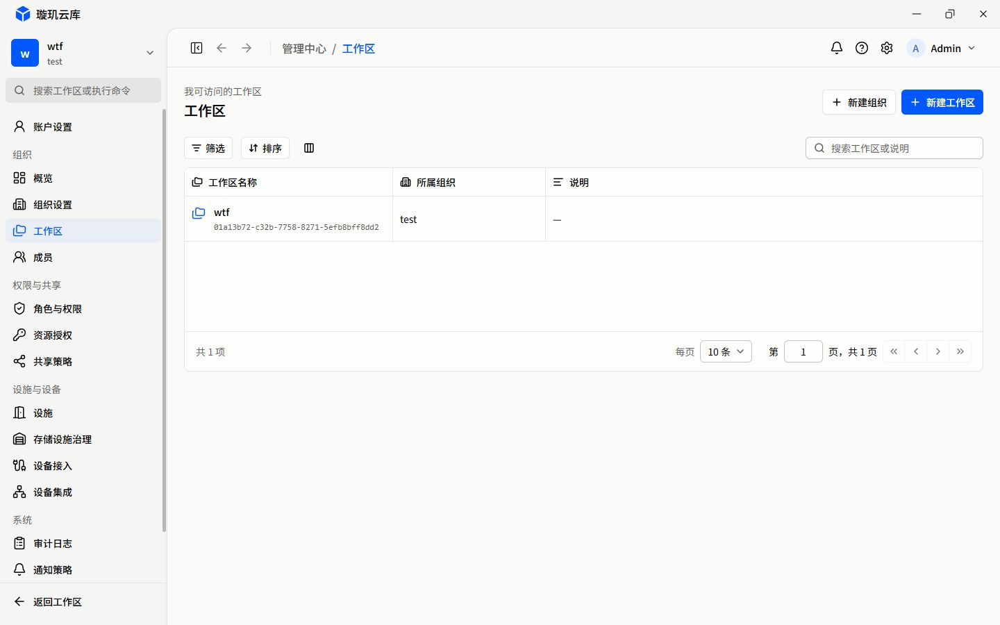

# R01 返工

日期：2026-10-16。起点：`f258ba85`。状态：代表页现有内容的构图已返工，完整验收待补。不是 R02 已完成，也不是 45 个路由已签收。

首轮记录与截图留在上级目录，作为不可覆盖的对照。此次先修改主计划和 foundation：R01 不再只负责容器尺寸，也负责现有内容的视觉构图；后续包继续负责业务契约与对象上下文。

## 本轮区域检查

| 代表图 | 设计意图 | 本轮实施边界 |
| --- | --- | --- |
| E-01 | 摘要横排，工作区主区与成员/治理辅区分层 | 有限宽度摘要、约 2:1 主辅区、紧凑未知状态；不造成员/风险/审计总量 |
| E-03 | 工作区身份为首要信息，组织和说明可扫读，动作与列表对齐 | 使用已有 name/id/description/organization 字段；说明单列填充；不加负责人、人数或详情路由 |
| E-10 | 成员身份、角色、状态与命令分层 | 既有成员表的身份、badge、列宽与响应式操作区；保留服务端搜索/分页及权限 |
| B-04 | 满宽对象头/标签，下方基本信息/批次为主，库存/动态为辅 | 现有模块按约 2:1 重排，低于 1000px 顺序单列；字段和专业业务不变 |
| A-01 / A-03 | 保留认可概览；摘要、工具栏、队列保持起始对齐 | 正常态隔离回归和列表交互；不恢复旧资产统计或 inline Inspector |

## 改了什么，为什么

首轮问题不只是“看图不够细”，计划也把尺寸和构图拆开得过细，给出了只修容器就完成 R01 的错误出口。本轮先修改 [主计划](../../README.md) 和 [foundation](../../foundation.md)，明确代表页的内容层级、动作、主辅关系属于 R01；缺失接口与对象路由仍留给后续包。没有通过放宽质量要求来解释现状。

- **E-01**：四项摘要采用有限宽度，未知总量显示“未获取”；工作区表与审计为主区，成员/邀请、授权与集成为辅区，可用宽度 1000px 起约 2:1。取消大空态反复占满模块的排法，不画假趋势、不用数组长度冒充组织成员总量。
- **E-03**：已有工作区名、ID、组织、说明形成身份与字段层级。新建组织为次动作，新建工作区为主动作。说明列显式承担剩余宽度，工具栏跟随实际表框；页面标明“我可访问的工作区”，不把当前全可访问集合说成仅当前组织。
- **E-10 / F-01**：复用既有 TeamManagement，身份、头像、角色与状态分层；组织/范围在左，命令在右；搜索与分页有稳定分组。成员/邀请表最低可读宽度 960px，角色表 640px，不足时只横滚表格。长角色徽标允许增高、换行且采用小圆角，避免被固定高度裁掉或挤成竖条。
- **B-04**：不改变对象头与本地标签的满宽容器。正文左侧基本信息和批次、右侧库存与动态；正文不足 1000px 后变为顺序单列。内部事实列表按自身宽度 640px 起两列，不再因主区占 2/3 而把十项字段拉成十行。
- **A-01 / A-03**：保留认可的工作台概览构图。回归摘要、工具栏与队列起始对齐，以及首列预览；不恢复旧 inline Inspector、旧资产统计或红色时间文本。

DataTable 的扩展只有一项明确策略：调用方可给已有列标记 `fill`，首个可见标记列在 min/max 内填充剩余宽度。未标记的表保留固定列宽；任何列开始手动调宽即固定当前自动填充宽度，显式 sizing 优先，清除填充列 sizing 才恢复自动布局。没有增加均分列、空白占位列或第二套表格布局引擎。

## 逐页对照

原图只用于信息架构和构图，沿用现有控件、颜色与浮层规则。此次针对每张代表图单独查看区域，不以批量缩略图代表视觉验收。

| 页面 | 原图与首轮 | 返工后 | 保留的差异及缺口 |
| --- | --- | --- | --- |
| E-01 | [设计](../../../../../../../output/design/frozen-v2-71-2026-09-29/E-01.png)、[首轮](../e-01-1440.jpg) | [1440px](e-01-1440.jpg) | 不照搬旧侧栏；成员/风险/审计聚合尚缺 reader |
| E-03 | [设计](../../../../../../../output/design/frozen-v2-71-2026-09-29/E-03.png)、[首轮](../e-03-1440-expanded.jpg) | [1440px](e-03-1440.jpg)、[1024px](e-03-1024.jpg)、[2560px](e-03-2560.jpg) | 已有字段重新组织；负责人/人数/资源数/更新及对象详情仍需 R02/R03 契约，不造空列 |
| E-10 | [设计](../../../../../../../output/design/frozen-v2-71-2026-09-29/E-10.png)、[首轮](../e-10-1440.jpg) | [真实成员](e-10-1440.jpg)、[长内容隔离检查](e-10-isolated-long.jpg)、[窄屏](e-10-isolated-long-1024.jpg) | 不恢复 inline Inspector；继续服务端分页，不换为客户端全量表 |
| F-01 | [设计](../../../../../../../output/design/frozen-v2-71-2026-09-29/F-01.png)、[首轮](../f-01-1440.jpg) | [真实角色](f-01-1440.jpg) | 仅改善共享团队组件的呈现，不提前添加 F-02 角色详情 |
| B-04 | [设计](../../../../../../../output/design/frozen-v2-71-2026-09-29/B-04.png)、[首轮隔离概览](../isolated-material-overview.jpg) | [1920px](b-04-isolated-1920.jpg)、[1024px](b-04-isolated-1024.jpg) | 隔离摘要数据；批次、库存数量、动态仍未加载，不算生产材料数据验收 |
| A-01 / A-03 | [A-01 设计](../../../../../../../output/design/frozen-v2-71-2026-09-29/A-01.png)、[A-03 设计](../../../../../../../output/design/frozen-v2-71-2026-09-29/A-03.png) | [认可构图回归](a-01-isolated-1440.jpg)、[待办列表](a-03-isolated-1440.jpg)、[预览](a-03-isolated-preview.jpg) | 仅隔离正常态回归；生产工作台 reader 仍不可用 |

## 运行验证

真实检查使用已运行的 `http://localhost:4444` 与既有会话；未写入业务数据、未切换组织/工作区、未更改权限。侧栏临时切换后已恢复展开。临时浏览器标签与视口覆盖已清理，用户原有标签页未关闭。

### 真实工作区视口矩阵

| 视口 | 展开侧栏：画布 / 表框 / 工具栏 | 收起侧栏：画布 / 表框 / 工具栏 | 页面 / 页脚横向溢出 |
| --- | --- | --- | --- |
| 1024 × 768 | 735px | 919px | 均为 0 |
| 1280 × 800 | 991px | 1175px | 均为 0 |
| 1440 × 900 | 1151px | 1200px | 均为 0 |
| 1920 × 1080 | 1200px | 1200px | 均为 0 |
| 2560 × 1440 | 1200px | 1200px | 均为 0 |

每个单元格为三者相同的实际宽度，不是仅 CSS 声明。1024px 展开侧栏时，业务列最小宽度超出表框，由局部原生 X 承接，不把整个页面拉宽。

### 状态与交互

一次性隔离入口采用新 Pinia、显式隔离数据源，复用真实组件；不是生产 fallback。临时入口现已删除，没有新增长期测试脚本。

| 场景 | 结果 | 证据 |
| --- | --- | --- |
| 0 / 1 条记录 | 画布、表框和工具栏保持 1152px；空态占满 171px 记录视口 | [0 条](isolated-0.jpg)、[1 条](isolated-1.jpg) |
| 10 条长中文和多行说明 | 布局不缩小、内容换行，页脚无横向溢出 | [截图](isolated-10-long.jpg) |
| 100 条、页容量 100 | 100 条挂载，局部滚动，页脚保留；未据此声称性能全量签收 | [截图](isolated-100.jpg) |
| 最小列集合 | 只留选择/动作列时，框及工具栏 190px，页脚不横溢 | [截图](isolated-actions-only.jpg) |
| 填充列换位后调宽右侧列 | 鼠标 +40px，固定列 220→260px，填充列保持 442px，不吸收位移 | metrics.json 的 resizeAfterReorder |
| 原生横滚终点 | scrollLeft = 254 = 988 - 734，可抵达最右端；横滚 computed 为 smooth | [截图](isolated-native-x-end.jpg) |
| reduced-motion | 原生 X、两层被测 Y viewport 的 computed scroll-behavior 均 auto | metrics.json 的 reducedMotion |
| 长邮箱/角色 | 1024px 下页面无横溢，960px 表格局部横滚；长 Badge 高/scrollHeight 均 36px | [截图](e-10-isolated-long-1024.jpg) |
| 团队分页 | 隔离真实组件点击下一页显示第 2 / 3 页；未改 load 查询语义 | 原组件交互及源码审查；不当成真实 41 名成员 |
| 真实工作区预览 | Enter 打开字段 Sheet，Esc 关闭并归还焦点至原身份按钮 | [预览](e-03-preview.jpg)、metrics.json 的 keyboardPreview |
| 真实搜索无结果 | 画布和表框不缩小；当前调用方仍显示“暂无可用工作区”，文案细分留 R02 | [截图](e-03-filter-empty.jpg) |
| 材料正文 | 1920px 下主/辅宽约 837/419px，基本信息内部双列；1024px 下主辅单列，无页面横溢 | 两张 B-04 隔离截图 |

完整数值见 [metrics.json](metrics.json)，文件尺寸和 SHA-256 见 [manifest.json](manifest.json)。

## Standards

独立只读审查发现两项问题，现已修复并复核关闭：自动填充可能抵消右侧列调宽、固定高度 Badge 裁切长角色。额外逐图复看纠正了窄屏角色列过窄的问题。最终无未解决的阻断项；审查者未独立复验浏览器证据。

## Spec

独立只读审查确认生产变更与修订后的 R01 边界一致，未发现把本包构图责任推回 R02 的明确源码缺项，也未发现新接口、对象路由或查询命令等越界。原生 125% 和完整权限矩阵仍保留待验收。

## 工程检查与未通过门禁

- `pnpm --filter @talos-ark/frontend type-check` 通过；作用文件根级 `pnpm exec eslint ...` 通过，无错误或警告；`pnpm --filter @talos-ark/frontend vite:build` 通过。构建仍提示既有大 chunk，不借此恢复用户已移除的路由懒加载。
- 全量 Vitest 已运行：1 个套件 / 1 个测试通过，17 个套件因历史 `shared/api`、`stores`、`schemas`、旧页面等已删除路径而无法加载，与首轮记录一致。未新增兼容 stub 或顺手修复旧测试。
- 原生浏览器 125% 缩放尚未取得有效证据；DPR 或 pinch 不能替代，未标通过。
- 全权限、IME、触控板、跨组织越权、真实写入和同步失败矩阵未执行；本轮没有改这些业务路径，不将源码未变当成验收通过。
- 工作台/资源缺真实 reader；管理概览缺聚合/活动数据。截图中未知值不是空数据或成功态，隔离截图不是接线验收。
- 深色主题和全部 45 个路由未逐页复验。R01 当前为“代表页构图已返工，完整验收待补”，不是全站完成声明。
